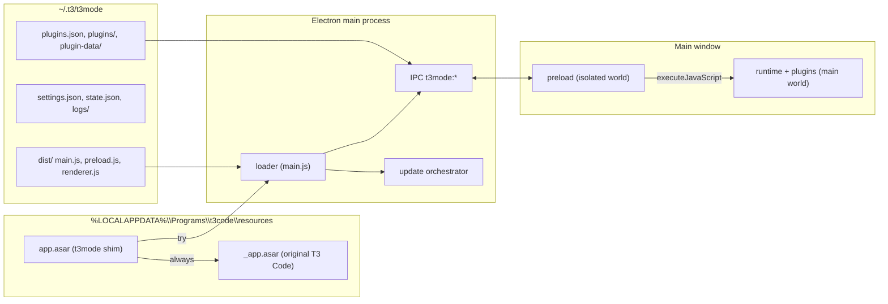

# t3mode architecture

Status: **M3 done** (loader, CLI, page runtime, settings pages, shortcut, and t3mode installing T3 Code's updates), verified on a sandbox copy of T3 Code `0.1.10-nightly.20261114.4669`, and the update path also on a real install. Standalone plugins (section 5) are verified on a sandbox copy of `0.1.10-nightly.20261115.4736`. Decisions are recorded under **Decided**.

## Goal

t3mode adds plugins to the T3 Code desktop app on Windows, the way Vencord does for Discord. T3 Code's own code is never edited. t3mode runs alongside it at startup and changes the interface from inside the window.

The repo ships the loader, the runtime, the settings pages and the plugin SDK. Plugins are projects of their own. Anyone can publish one as a GitHub release, and anyone can install it from its link (see Plugins below). That is the opposite of Vencord, which builds every plugin into one bundle.

Non-goals for v1: macOS support, sandboxing plugins, a central plugin catalog, computer control, dictation, storing secrets.

## Facts about the target

Checked on this machine against `0.1.10-nightly.20261114.4669`:

| Fact                                         | Value                                                                                                                  | Why it matters                                                                                     |
| -------------------------------------------- | ---------------------------------------------------------------------------------------------------------------------- | -------------------------------------------------------------------------------------------------- |
| Install dir                                  | `%LOCALAPPDATA%\Programs\t3code\`                                                                                      | Per-user, so no admin rights are needed to swap files                                              |
| Entry                                        | `app.asar` → `package.json` `main` = `apps/desktop/dist-electron/boot.cjs`                                             | What the shim has to boot                                                                          |
| Other archives                               | `server.asar`, `app.asar.unpacked`, `wsl-runtime.tar.gz`                                                               | Leave them alone. Only `app.asar` is swapped                                                       |
| Fuse `EnableEmbeddedAsarIntegrityValidation` | off                                                                                                                    | A swapped `app.asar` is accepted. **If upstream turns this on, the whole approach stops working.** |
| Fuse `OnlyLoadAppFromAsar`                   | off                                                                                                                    |                                                                                                    |
| Fuse `RunAsNode`                             | on                                                                                                                     | `ELECTRON_RUN_AS_NODE=1` works, so helper scripts need no separate Node install                    |
| `NODE_OPTIONS` fuse                          | on, but packaged Electron ignores `--require`                                                                          | No way to inject without swapping the archive                                                      |
| Windows                                      | `sandbox: true`, `contextIsolation: true`, `nodeIntegration: false`                                                    | The preload is sandboxed. Plugins must be injected into the main world                             |
| Page bridge                                  | `window.desktopBridge`                                                                                                 | T3 Code's own preload API. Read it, never replace it                                               |
| Updater                                      | electron-updater, GitHub `pingdotgg/t3code`, channel `nightly`, cache `%LOCALAPPDATA%\t3code-updater\pending\`         |                                                                                                    |
| Update off switch                            | env `T3CODE_DISABLE_AUTO_UPDATE` (in `apps/desktop/src/updates/DesktopUpdates.ts`)                                     | Lets t3mode take over updates (see Updates)                                                        |
| Nightly cadence                              | about every 6 h                                                                                                        | Repairing after an update is an everyday path, not an edge case                                    |
| Update feed                                  | `resources/app-update.yml` names the repo and publisher; each release has `<channel>.yml` with the installers' SHA-512 | t3mode reads the same feed as T3 Code's updater                                                    |
| Update channel                               | `updateChannel` in `<T3 home>/userdata/desktop-settings.json` (Settings → About → Update track), else from the version | t3mode follows the channel the user picked in T3 Code                                              |
| Installer                                    | NSIS, per user, signed "CN=T3 Tools Inc"; electron-updater runs it as `--updated /S --force-run`                       | t3mode runs it as `--updated /S`, then re-applies the shim before starting T3 Code                 |
| Detached console processes                   | Node's `detached: true` starts a process without a console, and `powershell.exe` exits at once without one             | The update helper is started through `Start-Process` (see Updates)                                 |
| Loaded `.node` files                         | Windows locks a loaded native module until its process exits: no rename over it, no delete of its folder               | Update, remove and disable stop a plugin's processes first (see Plugins)                           |
| Stable DOM hooks                             | `data-*` attributes listed in T3 Code's theme guide (`[data-thread-details-card]`, `[data-chat-composer-form]`, …)     | Prefer these over class names, which change between releases                                       |

Run `pnpm t3mode doctor` (see CLI) to check the fuses, original entry, update feed, bundle tokens and runtime DOM hooks. The canary runs these checks on new nightlies.

## Overview



## Layers

### 1. Shim (`packages/shim`)

The new `app.asar`. Kept tiny and rarely changed, because every change means reinstalling it.

- Contains `index.js`, a `t3mode.json` marker holding the shim version, and a `package.json` copied from the original with only `main` changed. Electron reads the app's name and version from the entry archive, so they stay T3 Code's.
- `index.js` loads `~/.t3/t3mode/dist/main.cjs` **inside try/catch**. If loading fails, it writes `logs\shim.log` and continues.
- Then it always boots the original: `app.setAppPath(_app.asar)`, then `require` the original `main`.
- `T3MODE_DISABLE=1` skips the loader. `SAFE_MODE` is handled by the loader (below).
- Bundled from `packages/shim` with no runtime dependencies and no Effect.

Fixes a t3mod weakness: in t3mod, a broken loader keeps T3 Code from starting.

The shim, loader, and CLI share `resolveHomeRoot`. `T3MODE_HOME` overrides the data folder. Otherwise it is `<T3CODE_HOME>/t3mode`, or `~/.t3/t3mode` when `T3CODE_HOME` is unset. `install` and `repair` move the legacy `%APPDATA%\t3mode` folder when using the default home and the new root does not exist. If both folders exist, they leave both untouched and report that the old folder is unused.

### 2. Loader (`packages/main`)

Runs in the main process before T3 Code's own code.

Everything here runs **synchronously** (`Effect.runSync` over sync file access), because the shim boots T3 Code right after `require` returns. IPC handlers and the preload hook must exist before T3 Code opens its window.

1. **Safe mode.** Two triggers, each skipping t3mode for one launch:
   - the `SAFE_MODE` file (`pnpm t3mode safe`, or two renderer crashes within 60 s);
   - two launches in a row that never reported `ready` from the page (`state.json` counts them).

   Safe mode still runs the updater (step 5), so an update during safe mode doesn't silently uninstall t3mode.

   Safe mode starts no plugin backend. It leaves plugin tool servers registered (see Plugins). Claude and Codex start them as their own processes, so they can't stop T3 Code from booting, and safe mode protects only that boot.

2. **Settings and state.** JSON files written atomically (write a temp file, then rename), decoded with `Schema`.
3. **IPC.** `t3mode:*` handlers. Every handler checks that the call comes from the main frame of the main T3 Code window. The surface is small and allowlisted.
4. **Preload registration** through `session.registerPreloadScript` on every session. The preload itself exits outside the main window.
5. **Updater** (`Updater.ts`, see Updates). Before T3 Code's main runs, it sets `T3CODE_DISABLE_AUTO_UPDATE=1` unless the user handed updates back to T3 Code.
6. **Plugin programs** (`Reconcile.ts`, `Backends.ts`, see Plugins). After app ready, one reconcile starts the enabled plugins' backends and registers their tool servers.
7. **Boot the original**, always, even when steps 1 to 6 fail.

### 3. Preload (`packages/preload`)

- Runs only in the main `t3code://app` frame. It does nothing in the preview browser, pop-ups or data: pages.
- Adds "T3 Mode v<version>" to T3 Code's boot splash (`#boot-shell`) once the page has parsed, before T3 Code's scripts run. The label goes away with the splash.
- Exposes `window.t3modeNative` through `contextBridge`. Each method is one IPC call.
- Reads the page scripts from main over IPC (each installed plugin, then `renderer.js`) and runs each in the main world with its own `webFrame.executeJavaScript` call. That gets past the page's CSP and lets plugins reach React-managed DOM. A script that fails is logged, and the rest still run.

### 4. Runtime (`packages/runtime`)

Runs in the page, as one classic script with no imports. Plain TypeScript, no Effect: it is small, runs once per page load, and Effect would add about 100 kB to a script that the preload hands to `executeJavaScript` on every reload.

- `renderer.ts` reads `info` and settings from main, starts the `Runtime`, follows the plugin backends, starts the plugins, adds the settings entry and the shortcut, then calls `ready()` so the crash guard counts the launch as healthy. Following the backends first means a plugin sees its backend's status from its first `onStatus` call.
- `Runtime` starts and stops plugins and keeps settings in memory. Each change is written back through `writeSettings`, which validates it with a Schema in main before it reaches `settings.json`.
- **Disposables.** Everything a plugin creates goes through its API (`css`, `observe`, `listen`, `interval`, `element`, `settingsPanel`, `onCleanup`) and is undone newest first when the plugin stops. Changing an option restarts the plugin.
- **Fault isolation (sync only in v1).** `start` and every API callback are wrapped. A plugin that throws is stopped, its changes are undone, the error goes to `main.log` and a toast points to the settings page, where Retry starts it again. For a plugin that couldn't load, Retry first reads its files again, so a fixed linked plugin starts without a reload. Errors in a plugin's own promises are not attributed yet.
- **Status.** Plugins call `api.report({ state: "active" | "waiting", detail })`. The settings page shows it, so "T3 Code's usage data was not found" after an update is visible instead of a silent no-op.
- **Settings pages** (`ui/settingsPage.ts`, `ui/native.ts`). A "T3 Mode" group is added to T3 Code's settings navigation, after "Connections": a copy of that native group with two entries, like Vencord's. **T3 Mode** shows the version and troubleshooting (logs folder, safe mode, uninstall). **Plugins** has an "Install from GitHub" field and "Check for updates", and lists the installed plugins as cards (switch, status, version and source, search and an enabled/disabled filter). Each plugin has its own page for its options, its source, Update and Remove (Settings / Plugins / name). The pages open in the settings pane itself, with T3 Code's breadcrumb header.
- **Shortcut** (`ui/shortcut.ts`, `lib/keybindings.ts`, main's `T3Keybindings.ts`). Ctrl+Alt+M (Cmd+Alt+M on macOS) opens the Plugins page. It is listed and rebindable in T3 Code's own Settings → Keybindings, as "Run Script: T3 Mode Plugins" with a "T3 Mode" badge.
  - **Why a script command.** T3 Code's keybindings file only accepts its own commands, plus `script.<id>.run` for project scripts, whose ids are free. So t3mode adds `{ "key": "mod+alt+m", "command": "script.t3-mode-plugins.run" }` to `<T3 Code home>/userdata/keybindings.json`. T3 Code shows that entry in Settings → Keybindings and lets the user rebind it there, and it ignores the key press, because no project has that script.
  - **Seeded once.** Main adds the entry on the first start, with an atomic write, and leaves a marker (`shortcut-seeded`). It never edits or removes the user's entries. If the user deletes the binding, it stays deleted, and the T3 Mode page offers a Restore button. If Ctrl+Alt+M is already bound to something else, nothing is added. T3 Code reloads the file on its own, so changes apply without a restart.
  - **Handling the key.** The page listens for key presses before T3 Code does. It resolves each press against T3 Code's live bindings, read from React state, the way T3 Code does: same "When" clauses, and the last matching rule wins. A rebind applies at once and the old key stops working. If those bindings can't be read after an update, it falls back to Ctrl+Alt+M and logs a warning.
  - **Native look.** T3 Code's stylesheet only holds the Tailwind classes T3 Code uses, so `native.ts` copies whole class strings from T3 Code's live settings components (group, row, switch, select, buttons, header) and rebuilds their markup. t3mode's own layout (the card grid, status dots) is plain CSS on T3 Code's theme variables.
  - **No React nodes touched.** The page is appended as the pane's last child, and React's children are hidden with CSS while it is open. Clicking a native section, typing in the settings search or a route change closes it. While it's open, t3mode's entry is marked active and the native one inactive; the native one is restored when the page closes.
  - **Popups stay in the dialog.** Select popups open inside the page, not in `document.body`, because T3 Code's dialog closes on presses outside itself. Escape in a popup closes only the popup.
- **Plugin storage.** `api.storage` keeps state in `<home>/plugin-data/<id>.json`, including for linked plugins. Reads use an in-memory startup snapshot. Writes update memory immediately and coalesce background file writes per plugin. Install and update preserve the file. Removing the plugin deletes it. `uninstall --purge` deletes it with the whole home. A file that exists but isn't a JSON object is never written over: the plugin sees `storage.readable` false, `get` returns fallbacks, and `set` stores nothing until the file is fixed and T3 Code reloads. `storage.path` is the file's absolute path, for display. Existing localStorage data is not migrated.
- **Plugin sections.** `api.settingsPanel(title, render)` adds a section below Options on the plugin's page (Settings / Plugins / name) while the plugin runs. The page calls `render(host)` each time it draws, and the section goes away when the plugin stops. `api.ui` gives the section T3 Code's look: `group(...rows)`, `row({ title?, description?, control? })`, whose description can be a node such as a textarea, and `button({ text, variant?, onClick })`. They are `native.ts`'s own builders, so a plugin never copies T3 Code's class strings.
- **Hot reload.** `renderer.js` is re-read on each page reload, so `pnpm t3mode deploy` then Ctrl+R picks up page changes. Main and preload changes need a restart.

### 5. Plugins (`packages/plugin-sdk`, `packages/shared/src/Plugin*.ts`)

**Decided: plugins installed from GitHub.** Authors can publish one plugin or several plugins from one repository. Users paste the repository link on the Plugins page and choose what to install. The repo ships no plugins. This replaces the M2 decision, where plugins were compiled into `renderer.js` from a git-ignored `userplugins/` folder.

**Trust.** A plugin's page code runs in T3 Code's main world, with the same reach as T3 Code's own page code. That includes the DOM, `window.desktopBridge` and `window.t3modeNative`. It can't be sandboxed without losing the DOM, which is the reason plugins exist. The page is one trust domain: every plugin's page code, T3 Code's code and t3mode's runtime share it, and nothing in it can tell them apart. So the plugin API is cooperative, not a boundary, and a plugin's backend and tool server have the user's full rights. Installing a plugin means trusting its author, as with a VS Code extension or an Obsidian plugin. t3mode does four things about it.

- It shows the repo, author and version, with a warning, before it installs anything.
- It pins each install to its version and the SHA-256 of its code.
- It never updates a plugin without a click.
- Safe mode starts T3 Code without any plugin code in its window, and without any backend. Tool servers stay registered with Claude and Codex, because they run outside T3 Code and can't break its boot.

**A plugin folder** holds a manifest, page code, and optional program files. An installed copy and a linked dev build use these names. A single-plugin release uses them too.

- `manifest.json` is `{ "id", "name", "version", "description", "author"?, "backend"?, "mcp"?, "files"?, "api": 1 }`. `id` must match `^[a-z0-9][a-z0-9-]{0,63}$`, because it becomes a folder name, a settings key and a string in generated code. `version` is a semantic version, compared to find updates. `api` is the plugin API's major version, and t3mode refuses a plugin built for another one. The manifest is read without running any code, so the install prompt and the Plugins page can show it.
- `plugin.js` is a CommonJS bundle, at most 5 MiB, whose default export is `definePlugin({ options, start })`. Everything it imports is bundled in. The types and `definePlugin` come from `@t3mode/plugin-sdk`.

```ts
import { definePlugin } from "@t3mode/plugin-sdk";

export default definePlugin({
  options: {
    mode: { type: "select", label: "Mode", choices: [/* … */], default: "a" },
  },
  start(api) {
    api.observe(() => {
      const toggle = api.queryFirst<HTMLButtonElement>(["[data-thread-panel-toggle] button"]);
      /* … */
    });
  },
});
```

**Local sockets (removed).** Earlier builds let page code open Windows named pipes that its manifest declared in `sockets`, through main. Main couldn't tell which plugin was calling, because the page is one trust domain, so the allowlist was a weak gate. A backend does that work now, as its plugin's own process. A manifest or lockfile entry that still has `sockets` decodes, and the field is ignored. `api.sockets.connect` stays in the SDK's types, deprecated, and always rejects. No published plugin declared `sockets` when it was removed.

**Monorepos.** A root `t3mode.json` maps plugin ids to built folders.

```json
{ "plugins": { "alpha": "packages/alpha/dist", "beta": "packages/beta/dist" } }
```

Keys follow the manifest id rules. Routes are relative POSIX paths. Absolute paths, backslashes, empty segments, and `.` or `..` segments are invalid. A registry contains 1 to 50 plugins. Downloaded registries have the same 64 KiB limit as manifests.

One GitHub release contains `t3mode.json`, `<id>.manifest.json`, and `<id>.plugin.js` for every plugin. Every release carries every plugin, changed or not, because installs and update checks download from the latest release. The registry is uploaded verbatim. Release downloads use only its keys. Main never uses its routes to fetch files.

`plugin link <folder>` reads the root registry and resolves every route from that folder. Each built manifest must match its registry key. The store validates every plugin before writing the lockfile once. Without a registry, the command links the folder as one plugin.

**Program files.** API 1 manifests can name a `backend` script, an `mcp` script, and a `files` array of extra assets. Script names end in `.js` or `.cjs`. File names contain 1 to 100 letters, digits, dots, underscores, or hyphens, start with a letter or digit, and don't end in a dot. No two extra names may differ only by case, because Windows stores them as one file. Reserved names are `manifest.json`, `plugin.js`, and `t3mode.json`. The deduplicated extra set holds at most 20 files. Release assets use plain names for standalone plugins and `<id>.<name>` for registry plugins.

`plugin.js` has a 5 MiB cap. Each backend or MCP script has a 20 MiB cap. Each extra asset has a 64 MiB cap. All extras together have a 128 MiB cap. Downloads enforce the caps while streaming. The `mcp` script runs as a tool server, and the `backend` script as the plugin's backend (both below).

**The lockfile.** `<home>/plugins.json` lists what's installed, as `{ "version": 1, "plugins": { "<id>": { "source", "version", "sha256"?, "files"?, "backend"?, "mcp"?, "approved"? } } }`. A source is one of two kinds.

- `{ "kind": "github", "owner", "repo", "tag"?, "plugin"? }`. Its files come from the release. The URL is `https://github.com/<owner>/<repo>/releases/latest/download/<file>`, or `/releases/download/<tag>/<file>` when the install was pinned to a tag. They're copied to `<home>/plugins/<id>/`. These URLs aren't GitHub's REST API, so its limit of 60 requests an hour for unauthenticated clients doesn't apply. `sha256` is the hash of the installed `plugin.js`, and a copy that no longer matches it isn't loaded.
- `{ "kind": "local", "path" }`, added by `pnpm t3mode plugin link <folder>`, for developing a plugin. The two files are read from that folder on every page load, so a rebuild and Ctrl+R pick up changes. Only the CLI adds local sources. Main never takes a file path from page code. Its decode of the page's requests accepts GitHub sources only.

`files` maps every pinned file name to its SHA-256 hash, including `plugin.js`. `sha256` keeps the same hash for older t3mode versions. `backend` and `mcp` select pinned scripts. `approved` records the backend and MCP booleans. Older entries may also carry socket patterns, which are ignored. An older entry with only `sha256` reads as a `plugin.js` pin with its installed manifest's access approved. The next write upgrades it. Local sources have no pins and record their declared scripts and approved access.

A `plugins.json` that doesn't decode, including one with a key that isn't a valid id, reads as empty and is logged. Every install, link and remove is refused until it is fixed or deleted, so a bad edit is never written over.

**Install.** `PluginStore` (in shared, used by main and the CLI) does it in two steps.

1. **Preview.** Parse the link. It can be `owner/repo`, `github.com/owner/repo`, the repo URL or a release tag URL, with an optional `@tag`. Probe `manifest.json` first. If it exists, decode it and check its API and conflicts. If it is missing, fetch `t3mode.json` and check each named manifest with concurrency four. The preview returns the repository source and a list of offers. Each offer is ready with its source and manifest, or unavailable with its id and reason. A bad registry fails the preview. A bad plugin leaves the other offers available.
2. **Install**, on confirmation. Fetch the manifest again and refuse if its id differs from the one the user saw. The page and the CLI send the access they showed, and the install is refused if the release now declares more. Fetch every declared file with its size cap and hash it. Write each file next to its final name and rename it over, then write the lockfile entry. Delete obsolete files only after that write. Because the lockfile entry is written last, a crash midway leaves the old install or a hash mismatch, never a plugin that loads half-updated code.

An id that's already installed from another source is refused. A repo is the same source whatever its tag, so installing `owner/repo@v2` over `owner/repo` pins it, and GitHub names are compared without case. Running the same install twice ends in the same state. In main, requests go through Electron's `net.fetch`, like the updater's. `T3MODE_GITHUB_URL` replaces `https://github.com`, for tests and the sandbox.

The optional GitHub source field `plugin` selects a registry id. Downloads prefix manifest and code asset names with `<id>.`. Installed files keep plain names. The Plugins page keeps multiple offers open after an install and marks that offer installed.

**Updates.** "Check for updates" on the Plugins page, and `plugin update` in the CLI, fetch each unpinned GitHub plugin's latest `manifest.json` (`<id>.manifest.json` for a registry plugin) and compare versions. A newer one shows "Update to x.y" on its card. Nothing updates on its own, because a new release is new code. An update that adds backend or MCP access asks for approval before downloading code. The page lists the declared access and retries after approval. `plugin update --yes` approves without asking.

**Tool servers.** A plugin's `mcp` script is an MCP server over stdio, and it gives the plugin's tools to the agents T3 Code runs. For each enabled plugin with an `mcp` script, t3mode writes an entry named `t3mode-<id>` in two configs. A GitHub plugin's pinned files must all match. A linked plugin's script must exist.

- Claude's user config: `~/.claude.json`, or `$CLAUDE_CONFIG_DIR/.claude.json`, under `mcpServers`;
- Codex's: `~/.codex/config.toml`, or `$CODEX_HOME/config.toml`, as a `[mcp_servers.t3mode-<id>]` table.

The entry runs T3 Code's own exe on the script, with `ELECTRON_RUN_AS_NODE=1`. Users may have native Claude and Codex binaries and no Node install, so Node from PATH isn't an option.

- **Ownership.** Each entry also sets `T3MODE_HOME` to the home's root. That variable marks the entry as this home's. t3mode rewrites and removes only its own entries, so the sandbox and the real install share these files without touching each other's entries or the user's.
- **Taken names.** A name already used by an entry t3mode didn't write is left alone, and the plugin's tools aren't added there. The conflict is logged.
- **Codex.** `config.toml` is edited as text, and never through `codex mcp`, which rewrites the whole file. Only whole tables named `mcp_servers.t3mode-<id>` that carry this home's marker change, with their subtables. Comments after a t3mode table belong to what follows and stay. Line endings and the final newline are kept, so adding then removing an entry gives the file back byte for byte. A file that sets `mcp_servers = { ... }` inline is left alone and the refusal is logged, because TOML lets no table header extend an inline table.
- **Claude.** `.claude.json` is written only when its content changes, through a temp file and a rename. A file that doesn't parse is left alone.
- **Concurrent writes.** Claude and Codex rewrite their own config while they run. So each edit reads the file again just before its rename, and starts over from the new text when the file changed. After three tries it gives up, logs it, and the next reconcile tries again. The window for losing a write shrinks to that one read and rename.
- **Missing providers.** A provider that isn't set up is skipped: no `.claude.json`, or no Codex folder.
- **When.** Main reconciles the entries at launch, after app ready, and after every settings write. It also reconciles after every install, update and remove from the page, and when the page loads again (Ctrl+R). A run with nothing to change writes nothing and starts no process. Safe mode leaves the entries as they are. The CLI reconciles after `plugin add`, `update`, `remove` and `link`, and `uninstall` removes this home's entries.
- **Picking up changes.** Claude starts a server for each chat. Codex keeps one per `codex.exe`. A new entry is therefore used from the next Claude chat or the next Codex process.
- **Linked plugins.** Their tool servers are registered from their own folders. Those folders are outside `<home>/plugins/`, so main hands the update helper the folders of the enabled linked plugins that declare `mcp`, and the helper stops tool servers running from them too.
- **Other providers.** Only Claude and Codex are covered. T3 Code's other providers are untested.
- **Module type.** `<home>/plugins/package.json` holds `{ "type": "commonjs" }`. Node takes a `.js` file's module type from the nearest `package.json` above it. A user's `~/package.json` with `"type": "module"` would otherwise make every plugin script ESM, and `require` would fail.

**Stopping a plugin's processes.** Windows keeps a loaded `.node` file locked until its process exits. While it is loaded, the file can't be renamed over or deleted, and neither can its folder. This was reproduced in the sandbox:

- an update with a live tool server failed halfway, with one file replaced and a hash mismatch;
- a remove deleted the lockfile entry, then failed on the folder.

So one operation stops every process running T3 Code's exe whose command line names a file under `<home>/plugins/<id>/`, and waits for those processes to exit. It also matches on the exe, which spares Explorer or an editor opened on the folder. That finds tool servers. It can't find a backend: Electron starts a utility process with its own command line, which doesn't name the script. So main stops a backend itself, through the supervisor that started it.

- An update stops the plugin's backend and tool servers after its downloads and before its first write. The backend stays stopped until the update is written, then the reconcile starts the new version.
- A remove does the same before deleting the folder. The folder is deleted before the lockfile entry, so a remove that fails can run again. The plugin's storage file and data folder go last. A linked plugin's folder stays, but its backend still stops before its data folder goes.
- A backend that hasn't exited 5 s after main asked fails the update or remove, before any file changes.
- Disabling a plugin stops its backend through the reconcile, and its tool servers once its entries are gone.
- The CLI can't reach main's supervisor. While T3 Code runs, `plugin update` and `plugin remove` refuse a plugin with a backend, linked ones included, and say to use the Plugins page or close T3 Code.
- The update helper has its own copy (see Updates). Backends exit with T3 Code, before the helper starts.

**Backends.** A plugin's `backend` script is a program that runs beside T3 Code for as long as the plugin is on. It is the plugin's own Node process, for work that page code can't do, such as loading a native module.

- **One process each.** Main starts one Electron `utilityProcess` per enabled plugin with a backend, after app ready. A GitHub plugin's backend starts only when its pinned files all match. A linked plugin's runs from its folder. The process runs `backend-host.cjs` from `<home>/dist`, which loads the script with `require`. The script's default export is `defineBackend({ start })` from the SDK. `start(api)` gets `id`, `dataDir`, `send`, `onMessage` and `log`.
- **One reconcile.** `Reconcile.ts` compares the enabled plugins with what runs, and the supervisor (`BackendSupervisor.ts`, given Electron's `utilityProcess` by `Backends.ts`) starts, stops and restarts processes to match. Its tests drive it with a fake process and fake timers. It is the reconcile that registers tool servers (above), so it runs at the same times. A backend restarts when its files change: a GitHub plugin's pinned hashes, or a linked plugin's script modification time, so a rebuild and Ctrl+R pick it up. A disabled plugin runs no backend code.
- **Messages.** Page code calls `api.backend.send(data)`, and gets the backend's messages through `api.backend.onMessage` and its state through `api.backend.onStatus`. Data is anything structured clone copies. Main routes every message by the plugin id of the process it spawned, so a backend's messages always reach its own plugin. Page calls are cooperative: the page is one trust domain, and nothing stops a plugin's page code from calling `window.t3modeNative.backend` with another plugin's id. `send` resolves to false when no backend runs, and the host queues messages that arrive before the script calls `onMessage`.
- **Crashes.** A throw in `start`, an uncaught error, a rejected promise or an exit is a crash. Main restarts the backend after 1 s, then 2 s, 4 s, up to 10 s. Each restart, and Retry, goes through the reconcile, so the pinned files are checked again first. After 3 crashes within 60 s it gives up. The plugin's card shows "Backend stopped after 3 crashes" with the first line of the error, and Retry starts it again. A new version, or turning the plugin off and on, clears the crash record.
- **Data and logs.** Each backend gets `<home>/plugin-data/<id>/`, created before `start` and deleted when the plugin is removed. Its stdout, stderr and `api.log` lines go to `<home>/logs/plugins/<id>.log`, with a timestamp per line. When a line would take the log past 2 MiB, the writer moves it to `<id>.old.log` and starts a new one, so a backend that runs for days keeps at most about 4 MiB of logs.
- **Quit.** Main kills every backend in Electron's `will-quit`, before the update helper starts.
- **Isolation.** Each backend is a separate process. A crash, a hang or a leak in one doesn't reach T3 Code's main process or other plugins' backends, and main restarts only that one. That is crash containment, not a sandbox: a backend runs with the user's full rights, like any program they start.

**Loading.** The preload asks main for the page scripts. These are each installed plugin's `plugin.js`, wrapped by main, then `renderer.js`. The preload runs each one with its own `webFrame.executeJavaScript` call and `//# sourceURL=t3mode-plugin/<id>.js`, so a plugin that doesn't parse can't stop the others or the runtime. The wrapper registers the plugin's module under its manifest id without running it.

```js
(window.__t3modePlugins ??= []).push({
  id: "<id>",
  load: () => {
    const module = { exports: {} };
    (function (module, exports) {
      /* plugin.js */
    })(module, module.exports);
    return module.exports;
  },
});
```

The runtime calls `load()` inside its fault isolation, so an error in a plugin's top-level code stops only that plugin. It calls `load()` only for a plugin that is on, the first time it starts. A plugin that is off runs none of its code, not even its top level, so its options appear once it is first turned on. A plugin in `plugins.json` whose code didn't register, or whose files fail their checks, shows "Can't load" with the reason, and its card keeps Remove. After an install or update from the page, the preload's `loadPlugin(id)` runs the new code, and the runtime swaps it in without a reload.

**API.** `PluginApi` is a public contract, versioned by `api`. Besides the disposables above, it gives plugins the helpers that know T3 Code. These are `queryFirst`, `currentThreadKey`, `react.findPropsUp` and `react.findHookState`. They stay in t3mode, so when a nightly breaks one, a single t3mode fix repairs every plugin that uses it. `toast(message, kind?)` and `ui` reuse t3mode's own toast and settings components for the same reason. A toast from a plugin that has stopped is dropped. `disks()` returns each local fixed drive's root, size and free space. Main reads them with one `Win32_LogicalDisk` query, cached for 30 seconds and shared by every plugin. It skips network and removable drives, which can block for seconds when offline. The SDK marks it optional because older t3mode builds lack it. `backend` (SDK 1.4.0) is optional for the same reason.

**Writing a plugin.** `templates/plugin` is a starting point. It has the SDK, a build that writes `dist/manifest.json` and `dist/plugin.js`, and a GitHub Action that publishes release `v<version>` with both files when a push to `main` carries a `manifest.json` version that has no release yet. Link its `dist/` folder while developing. `templates/monorepo` is the same for several plugins in one repository. Its workflow publishes release `r-<short sha>` with every plugin when any manifest version differs from the latest release, and `plugin link` on its root links them all.

- **Rules.** Do the plugin's work in `start`, through the API, so turning it off undoes it. Drive T3 Code's own controls with `.click()` instead of rebuilding them. Never insert into or move React-owned nodes: overlay with `position: fixed`, or add next to React's children. Re-apply whenever the DOM changes, because React replaces nodes. Keep selectors in the plugin, newest markup first, and look them up with `api.queryFirst`.
- **Reading React state.** `api.react` reads the fiber React attaches to DOM nodes (`__reactFiber$…`). Component names are minified, so lookups match on the shape of the data: `findPropsUp` walks ancestors for props that pass a test, and `findHookState` walks the tree for hook state that passes a type guard. Either returns undefined when the shape changed, and the plugin reports "waiting".

### 6. CLI (`packages/cli`)

`t3mode <command>`. The CLI ships as `t3mode` on npm (`npx t3mode <command>`, or `npm install --global t3mode`): `dist/t3mode.cjs` is the whole CLI in one CommonJS file with no dependencies, and `dist/bundles/` holds the bundles that `install` and `deploy` copy into the home (shim, loader, preload, renderer, update helper, backend host; `repair.cjs` sits next to `t3mode.cjs`). The build defines `__T3MODE_PACKAGED__` in that bundle, so `Artifacts.ts` reads from `dist/` there and from each package's `dist/` when the repo runs it from source with `pnpm t3mode`. `.github/workflows/publish-cli.yml` publishes it when `packages/cli/package.json` has a version npm doesn't have. That version must equal `T3MODE_VERSION`. `sandbox` only runs from the repo.

| Command     | Does                                                                                                                                                                     |
| ----------- | ------------------------------------------------------------------------------------------------------------------------------------------------------------------------ |
| `install`   | Wait for T3 Code to close, rename `app.asar` to `_app.asar`, copy `app.asar.unpacked`, write the shim, copy `dist/`, relaunch                                            |
| `uninstall` | Restore the original, keep `~/.t3/t3mode` unless `--purge`                                                                                                               |
| `repair`    | Re-apply the shim after an update overwrote it                                                                                                                           |
| `status`    | Installed? Shim version, T3 Code version, mod enabled, last errors                                                                                                       |
| `deploy`    | Copy freshly built bundles into the home (renderer changes then need only Ctrl+R)                                                                                        |
| `sandbox`   | Copy T3 Code to `.sandbox/`, install there with its own data folders, start it with DevTools on port 9333                                                                |
| `safe`      | Next launch without the mod                                                                                                                                              |
| `plugin`    | `list`, `add <link> [id]` (select offers, `--yes` installs every ready offer), `update [id]`, `remove <id>`, `link <folder>` for one plugin or a monorepo in development |
| `status`    | Also shows a downloaded update waiting to install, and the update helper's last log lines                                                                                |
| `doctor`    | Check the fuses, original entry, update feed, bundle tokens and runtime DOM hooks                                                                                        |

`install`, `repair` and `uninstall` refuse to run while T3 Code is open (`--wait` waits for it to close). Plugin tool servers running T3 Code's exe don't count as T3 Code. They are stopped once T3 Code itself has closed, so a refused command leaves them running. `uninstall` also removes this home's tool server entries from Claude's and Codex's config. The new shim is built before anything is moved, and a failed swap puts the original back.

**Foreign shims.** If `app.asar` carries a t3mod or Vencord-style marker that isn't ours, `install` refuses and explains, instead of stacking shims.

## Updates

Every T3 Code update rewrites `app.asar`, which removes the shim. At one nightly every ~6 h, this path is the one that has to be reliable.

**Decided: A.** The options as weighed:

- **A. t3mode owns updates (chosen).** The loader sets `T3CODE_DISABLE_AUTO_UPDATE=1` before T3 Code's main runs, so T3 Code's updater stays idle. t3mode checks the same GitHub nightly feed, downloads the installer and **verifies its Authenticode signature (publisher "T3 Tools Inc")**. When T3 Code quits, a small detached helper:
  1. waits for T3 Code to exit,
  2. runs the installer silently and waits for **that process**,
  3. re-applies the shim,
  4. relaunches.

  The helper knows exactly which installer it's waiting for, and no vanilla T3 Code runs in between.
  Cost: t3mode re-implements check and download, and T3 Code's own update button shows "disabled".

- **B. Guardian (t3mod's approach).** Leave T3 Code's updater on. On quit, if an installer is pending, spawn a watcher that guesses when the installer finished, kills the relaunched vanilla T3 Code, re-swaps and relaunches. Less code. It relies on guessing ("any exe started from %TEMP%"), and it races the installer's own relaunch.

In both, the helper is a PowerShell script. It can't be T3 Code's exe in Node mode, because the installer has to overwrite that exe while the helper is running. `pnpm t3mode repair` stays the manual fallback.

### How it works (M3)

- **Turning T3 Code's updater off.** The loader sets `T3CODE_DISABLE_AUTO_UPDATE=1`, in safe mode too. T3 Code's About page then says automatic updates are disabled by that setting; its Update track select still sets the channel t3mode follows. The switch "Install updates through T3 Mode" on the T3 Mode page (`updates.manage` in `settings.json`, default on) hands updates back to T3 Code from the next launch.
- **Check** (`Updater.ts`, `UpdateFeed.ts`). 20 s after start, then every hour, and on "Check now": read `app-update.yml`, list the repo's releases through GitHub's API, take the newest release on the channel that has `<channel>.yml`, read it, and compare versions (semver with prerelease fields, so nightlies order by date and build). Requests go through Electron's `net.fetch`, so system proxies apply as they do for T3 Code.
- **Download and verify.** The installer for the CPU (`…-x64.exe` or `…-arm64.exe`) goes to `<home>/updates/<version>/`, with progress shown live on the T3 Mode page. It must match the size and SHA-512 from `<channel>.yml`, and `Get-AuthenticodeSignature` must report a valid signature whose common name is a publisher from `app-update.yml` ("T3 Tools Inc"). Anything else is deleted and reported. `updates/ready.json` records the verified installer, so a download survives a restart; the next launch after the install sees the new version and deletes it.
- **Install on quit.** In Electron's `will-quit`, if an update is ready, the loader starts `update-helper.ps1` (deployed to `<home>/dist`), which:
  1. waits for every process running from the install folder to exit (up to 2 minutes, else it gives up until the next quit). Plugin tool servers run T3 Code's exe, and Claude or Codex sessions outside T3 Code can keep them alive. Each time the helper checks, it stops every process of an exe in the install folder whose command line names a file under `<home>/plugins/` or under a linked plugin's folder that main passed it (`-PluginFolders`). Plugin backends exit with T3 Code, because main kills them in `will-quit`. Any other process still holds the update;
  2. runs the installer with `--updated /S` and waits for it;
  3. re-applies the shim by running `repair.cjs` with T3 Code's new exe in Node mode (`ELECTRON_RUN_AS_NODE=1`, with `process.noAsar` so .asar files are moved as files). `repair.cjs` is the CLI's own `applyShim`, bundled, so the CLI and the helper share one tested swap;
  4. after "Restart now", starts T3 Code again with the arguments it had.

  It logs each step to `logs/update.log`, and only one helper runs at a time.

- **Starting the helper.** It has to outlive T3 Code. Node's `detached` option starts a process without a console, and `powershell.exe` exits at once without one; a non-detached child is killed with T3 Code. So the loader runs a short PowerShell, attached and waited for (about half a second at quit), that starts the helper with `Start-Process`. The helper gets its own hidden console and is not tied to T3 Code (`HelperLaunch.ts`).
- **Sandbox.** The real installer always updates the real install, so the sandbox never runs it. `pnpm t3mode sandbox` writes `.sandbox/fake-installer.cmd`, which does to `app.asar` what an update does (puts a vanilla archive over the shim), and the loader runs that instead. Check, download and verification use the real feed.

## Repo layout

```
t3mode/
  packages/
    shared/      file layout, IPC contract, version, plugin sources and the plugin store
                 (bundled into each layer; the page and preload import only its plain files)
    plugin-sdk/  @t3mode/plugin-sdk: definePlugin and the plugin API types
    shim/        app.asar entry -> dist/index.cjs
    main/        loader: safe mode, IPC, preload hook, file log, updater -> dist/main.cjs;
                 assets/update-helper.ps1
    preload/     bridge and injection -> dist/preload.cjs
    runtime/     page code -> dist/renderer.iife.js: plugin runtime, settings pages
    cli/         install, repair, uninstall, deploy, status, safe, sandbox, plugin (run from source);
                 dist/repair.cjs for the update helper
  templates/
    plugin/      starting point for a standalone plugin, with its release workflow
    monorepo/    starting point for several plugins in one repository, with its release workflow
  docs/
  .sandbox/      dev copy of T3 Code (git-ignored)
```

**Decided: stack, matching T3 Code's own repo** (`pingdotgg/t3code`):

- TypeScript run natively by Node (type stripping), `tsconfig.base.json` copied from T3 Code.
- **Effect 4.1.3** and `@effect/platform-node` in the loader and the CLI, written in T3 Code's style: `Context.Service` classes, `Layer`, `Effect.fn`, `Schema.TaggedError`, `effect/cli`, `effect/process`.
- **effect-tsgo** typechecks with T3 Code's Effect language-service rules (`tsconfig.effect.json`, copied).
- **vite-plus 1.4.0** (`vp`): `vp pack` (tsdown) bundles each layer, `vp test` (vitest), `vp lint` (oxlint), `vp fmt` (oxfmt).
- pnpm 12 workspaces with a catalog pinned to T3 Code's versions.
- No Effect in the shim (it must never fail), the preload (sandboxed and tiny) or the page runtime (see Runtime above).

## Testing

- **Unit (vitest).** Now: safe-mode decisions; the asar swap on a fake install (install, refresh, re-apply after an update, uninstall, refusing another mod); option validation, thread keys, keybinding matching (key names, "When" clauses, last rule wins, finding the default key in the file), the settings schema, and the update feed (version order, `app-update.yml` and `<channel>.yml`, picking the release and installer, the signature decision, quoting the helper's command line). For plugins: parsing GitHub links, release URLs and the code wrapper (run in `node:vm`); `PluginStore` end to end against a local HTTP server standing in for GitHub (install, idempotence, the refusals, the hash check, link, remove, update checks, registry offers and partial failures, registry validation, prefixed release assets, monorepo links and atomic failure); and main's decode, which accepts registry GitHub sources and refuses local sources from page code. Later: runtime lifecycle and disposables, settings migrations.
- **Sandbox.** `pnpm t3mode sandbox`, then DevTools on port 9333. M1 was verified there: badge injected, `desktopBridge` intact, a crashing loader still lets T3 Code boot (error in `shim.log`), `safe` skips one launch, `uninstall` restores the original. M2 was verified there too: plugins found in `userplugins/` and none on a clean clone, settings and options persist, turning a plugin off removes everything it added, and the shortcut is added once, can be rebound in Settings → Keybindings, and can be restored after it's deleted. M3 was verified there: the real nightly feed found `0.1.10-nightly.20261114.4709`, its 372 MB installer downloaded with live progress and passed SHA-512 and signature checks; "Restart now" and a plain quit both ran the helper, the stand-in installer replaced the shim, `repair.cjs` under T3 Code's exe put it back, and after "Restart now" T3 Code started again with its arguments and t3mode loaded. Turning the setting off and on applies at the next launch.
  Standalone plugins were verified there with three linked plugins and a stand-in GitHub (`T3MODE_GITHUB_URL`).
  Backends were verified there on `0.1.10-nightly.20261116.4800`, with a stand-in GitHub release whose backend loads a native `.node` file, and a linked plugin with a backend and a tool server.
  - A message went from page code to the backend and back. The backend's data folder and log were written.
  - Two crashes restarted it after 1 s and 2 s. The third left it stopped, and the card showed the error with Retry, which started it again. A backend that throws in `start` gave up the same way, with the thrown message as the reason, and an update to a fixed version cleared it.
  - Turning the plugin off stopped its process, and turning it on started a new one.
  - An update from the Plugins page, with the `.node` file loaded, restarted the backend once on the new version, in 0.6 s. A `plugin update` from the CLI while T3 Code ran refused with a message.
  - A remove stopped the backend, then deleted the plugin folder and the data folder.
  - Ctrl+R kept a GitHub plugin's backend running, and restarted a linked one whose script changed.
  - Safe mode started no backend. A launch started the enabled ones.
  - At quit, main stopped the backends before the update helper started, and the helper stopped a tool server running from the linked folder, then installed the update.
  - The linked tool server was registered in `~/.claude.json` and `config.toml`. After the plugin was removed, both files matched their backups.
    Monorepos were verified there on `0.1.10-nightly.20261116.4761`, with a stand-in registry release of three plugins, one missing its assets.
  - The install panel listed the two ready plugins with their own Install buttons and showed the missing one's reason. Each installed without a reload, and the panel stayed open with it marked installed.
  - `plugins.json` recorded `source.plugin`, and each installed folder held plain `manifest.json` and `plugin.js`.
  - A single-plugin release still showed the classic panel. "Check for updates" found a newer registry plugin and updated it. After Ctrl+R, with the stand-in stopped, every plugin loaded from disk.
  - A plugin that doesn't parse is logged and skipped, and one whose top level throws shows "Can't load" with the error. The others and the runtime still start.
  - Installing `acme/example-plugin` from the Plugins page showed the prompt, downloaded both files through `net.fetch`, wrote `plugins.json` and started the plugin without a reload.
  - "Check for updates" found 1.1.0, and "Update to 1.1.0" swapped in the new code and removed the old code's stylesheet.
  - After a reload, the installed copy loaded from disk. After its `plugin.js` was edited, it was refused as changed since install.
  - A plugin whose top level counts its runs counted 0 after a reload while it was off, and 1 once it was turned on.
  - Requests to the stand-in carried Chromium's headers, so they go through `net.fetch`. The T3 Code update check still ran against the real feed.
  - Retry re-read a linked plugin that had been fixed on disk and started it. Remove deleted the files, the lockfile entry and everything the plugin added.
  - Against the real `https://github.com`, a repo whose release has no `manifest.json` and a missing repo both got a message, and main refused a local source sent from page code.
- **Real install.** On the real T3 Code install, the helper ran T3 Code's own installer and put the shim back, and T3 Code started with t3mode loaded. `pnpm t3mode status` shows the helper's log after each update.
- **DOM (vitest + happy-dom).** Plugins against saved HTML snapshots of T3 Code screens.
- **Compat canary.** Every 6 hours, `.github/workflows/canary.yml` downloads the newest nightly installer and extracts it without running it. `pnpm t3mode doctor` checks the Electron fuses, original entry, desktop bridge and updater switch, update feed, script commands and runtime DOM hook tokens. A release is skipped only after it passes. Workflow and doctor changes also run on pull requests. DOM snapshot tests remain open.

## Milestones

1. **M0.** Repo and this design. ✔
2. **M1.** Shim, loader, crash guard, logs, CLI `install` / `uninstall` / `repair` / `status`, and a "hello" plugin (a badge in the corner). ✔ Proven on a sandbox copy of the real app.
3. **M2.** Runtime, plugin API, settings pages, shortcut, user plugins. ✔ Proven on the sandbox.
4. **M3.** Update handling (option A). ✔ Proven on the sandbox and on a real install.
5. **Standalone plugins.** The plugin SDK, `plugins.json`, install from GitHub, `plugin link`, and the plugin template. ✔ Proven on the sandbox, with a stand-in for GitHub's release downloads.
6. **M4.** Doctor and compat canary done. DOM snapshot tests remain open.
7. **Later: patch engine** (see below).

## Later: patch engine

This would be Vencord-style find-and-replace on T3 Code's own code, for changes the DOM and React state can't make. One example is a real `t3mode.*` keybinding command instead of the script workaround. It is not planned yet; the notes below record what's known.

- **UI bundles.** T3 Code's main process serves the web client from `server.asar/apps/server/dist/client` through `electron.protocol.handle`. The loader runs before T3 Code's main, so it could wrap `protocol.handle` and patch matching JS responses in memory, without touching files on disk.
- **Server.** The server is a separate process: T3 Code's exe with `ELECTRON_RUN_AS_NODE=1`, entry `server.asar/apps/server/dist/bin.mjs`. Keybinding validation lives there, so patching it means either patching `server.asar` on disk, which every update undoes, or a `--require` / `NODE_OPTIONS` hook. Whether the fuses allow that hook hasn't been checked. In WSL mode the server runs under `wsl.exe` and can't be hooked from the loader.
- **Fragility.** Patches would be regexes against minified code that changes every nightly. Each patch needs a "find" that fails loudly and is skipped, like a plugin's "waiting" status. The compat canary (M4) should run every patch against each new nightly.

## Open questions

Settled: written from scratch (t3mod only informs the design). t3mode itself is installed from the repo. t3mode and the SDK are MIT licensed, so plugin authors may use the SDK and license their own plugins as they like. Plugins are shared as standalone GitHub releases. The first one is `Hezaerd/t3mode-thread-details-collapsed`.

- **Publishing the SDK.** `@t3mode/plugin-sdk` is on npm, published by the `t3mode` org. To publish, bump `version` in `packages/plugin-sdk/package.json` and merge to `main`. `.github/workflows/publish-sdk.yml` publishes any version npm doesn't have yet through npm trusted publishing, so no token is stored. Pull requests that touch the SDK run it as a dry run. Its `repository` field must stay `Hezaerd/t3mode`, because npm checks it against the workflow's repo. A change to `PluginApi` that breaks plugins needs a new major version and a new `api` number.
- **Discovery.** Install-by-link needs no registry. If one is wanted later, a GitHub repo holding a JSON list that authors add to by pull request would do, the way Obsidian lists its plugins.
