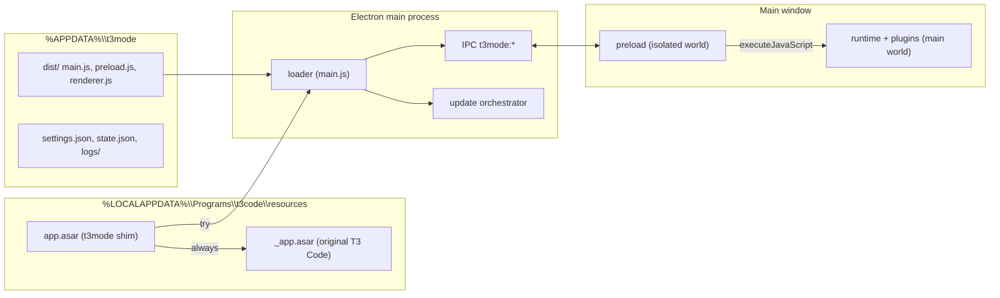

# t3mode architecture

Status: **M2 done** (loader, CLI, page runtime, settings pages and the shortcut), verified on a sandbox copy of T3 Code `0.1.10-nightly.20261114.4669`. Decisions are recorded under **Decided**.

## Goal

t3mode adds plugins to the T3 Code desktop app on Windows, the way Vencord does for Discord. T3 Code's own code is never edited. t3mode runs alongside it at startup and changes the interface from inside the window.

The repo ships the loader, the runtime and the settings pages. Plugins are personal and stay out of the repo (see Plugins below).

Non-goals for v1: macOS support, loading third-party plugins at runtime, computer control, dictation, storing secrets.

## Facts about the target

Checked on this machine against `0.1.10-nightly.20261114.4669`:

| Fact                                         | Value                                                                                                              | Why it matters                                                                                     |
| -------------------------------------------- | ------------------------------------------------------------------------------------------------------------------ | -------------------------------------------------------------------------------------------------- |
| Install dir                                  | `%LOCALAPPDATA%\Programs\t3code\`                                                                                  | Per-user, so no admin rights are needed to swap files                                              |
| Entry                                        | `app.asar` → `package.json` `main` = `apps/desktop/dist-electron/boot.cjs`                                         | What the shim has to boot                                                                          |
| Other archives                               | `server.asar`, `app.asar.unpacked`, `wsl-runtime.tar.gz`                                                           | Leave them alone. Only `app.asar` is swapped                                                       |
| Fuse `EnableEmbeddedAsarIntegrityValidation` | off                                                                                                                | A swapped `app.asar` is accepted. **If upstream turns this on, the whole approach stops working.** |
| Fuse `OnlyLoadAppFromAsar`                   | off                                                                                                                |                                                                                                    |
| Fuse `RunAsNode`                             | on                                                                                                                 | `ELECTRON_RUN_AS_NODE=1` works, so helper scripts need no separate Node install                    |
| `NODE_OPTIONS` fuse                          | on, but packaged Electron ignores `--require`                                                                      | No way to inject without swapping the archive                                                      |
| Windows                                      | `sandbox: true`, `contextIsolation: true`, `nodeIntegration: false`                                                | The preload is sandboxed. Plugins must be injected into the main world                             |
| Page bridge                                  | `window.desktopBridge`                                                                                             | T3 Code's own preload API. Read it, never replace it                                               |
| Updater                                      | electron-updater, GitHub `pingdotgg/t3code`, channel `nightly`, cache `%LOCALAPPDATA%\t3code-updater\pending\`     |                                                                                                    |
| Update off switch                            | env `T3CODE_DISABLE_AUTO_UPDATE` (in `apps/desktop/src/updates/DesktopUpdates.ts`)                                 | Lets t3mode take over updates (see Updates)                                                        |
| Nightly cadence                              | about every 6 h                                                                                                    | Repairing after an update is an everyday path, not an edge case                                    |
| Stable DOM hooks                             | `data-*` attributes listed in T3 Code's theme guide (`[data-thread-details-card]`, `[data-chat-composer-form]`, …) | Prefer these over class names, which change between releases                                       |

Re-check all of this with `t3mode doctor` (see CLI) after big upstream releases.

## Overview



## Layers

### 1. Shim (`packages/shim`)

The new `app.asar`. Kept tiny and rarely changed, because every change means reinstalling it.

- Contains `index.js`, a `t3mode.json` marker holding the shim version, and a `package.json` copied from the original with only `main` changed. Electron reads the app's name and version from the entry archive, so they stay T3 Code's.
- `index.js` loads `%APPDATA%\t3mode\dist\main.cjs` **inside try/catch**. If loading fails, it writes `logs\shim.log` and continues.
- Then it always boots the original: `app.setAppPath(_app.asar)`, then `require` the original `main`.
- `T3MODE_DISABLE=1` skips the loader. `SAFE_MODE` is handled by the loader (below).
- Bundled from `packages/shim` with no runtime dependencies and no Effect.

Fixes a t3mod weakness: in t3mod, a broken loader keeps T3 Code from starting.

### 2. Loader (`packages/main`)

Runs in the main process before T3 Code's own code.

Everything here runs **synchronously** (`Effect.runSync` over sync file access), because the shim boots T3 Code right after `require` returns. IPC handlers and the preload hook must exist before T3 Code opens its window.

1. **Safe mode.** Two triggers, each skipping t3mode for one launch:
   - the `SAFE_MODE` file (`pnpm t3mode safe`, or two renderer crashes within 60 s);
   - two launches in a row that never reported `ready` from the page (`state.json` counts them).

   From M3, safe mode will still run the update orchestrator, so an update during safe mode doesn't silently uninstall t3mode.

2. **Settings and state.** JSON files written atomically (write a temp file, then rename), decoded with `Schema`.
3. **IPC.** `t3mode:*` handlers. Every handler checks that the call comes from the main frame of the main T3 Code window. The surface is small and allowlisted.
4. **Preload registration** through `session.registerPreloadScript` on every session. The preload itself exits outside the main window.
5. **Update orchestrator** (see Updates).
6. **Boot the original**, always, even when steps 1 to 5 fail.

### 3. Preload (`packages/preload`)

- Runs only in the main `t3code://app` frame. It does nothing in the preview browser, pop-ups or data: pages.
- Exposes `window.t3modeNative` through `contextBridge`. Each method is one IPC call.
- Reads `renderer.js` from main over IPC and runs it in the main world with `webFrame.executeJavaScript`. That gets past the page's CSP and lets plugins reach React-managed DOM.

### 4. Runtime (`packages/runtime`)

Runs in the page, as one classic script with no imports. Plain TypeScript, no Effect: it is small, runs once per page load, and Effect would add about 100 kB to a script that the preload hands to `executeJavaScript` on every reload.

- `renderer.ts` reads `info` and settings from main, starts the `Runtime`, adds the settings entry and the shortcut, then calls `ready()` so the crash guard counts the launch as healthy.
- `Runtime` starts and stops plugins and keeps settings in memory. Each change is written back through `writeSettings`, which validates it with a Schema in main before it reaches `settings.json`.
- **Disposables.** Everything a plugin creates goes through its API (`css`, `observe`, `listen`, `interval`, `element`, `onCleanup`) and is undone newest first when the plugin stops. Changing an option restarts the plugin.
- **Fault isolation (sync only in v1).** `start` and every API callback are wrapped. A plugin that throws is stopped, its changes are undone, the error goes to `main.log` and a toast points to the settings page, where Retry starts it again. Errors in a plugin's own promises are not attributed yet.
- **Status.** Plugins call `api.report({ state: "active" | "waiting", detail })`. The settings page shows it, so "T3 Code's usage data was not found" after an update is visible instead of a silent no-op.
- **Settings pages** (`ui/settingsPage.ts`, `ui/native.ts`). A "T3 Mode" group is added to T3 Code's settings navigation, after "Connections": a copy of that native group with two entries, like Vencord's. **T3 Mode** shows the version and troubleshooting (logs folder, safe mode, uninstall). **Plugins** lists the plugins as cards (switch, status, search and an enabled/disabled filter), and each plugin has its own page for its options (Settings / Plugins / name). The pages open in the settings pane itself, with T3 Code's breadcrumb header.
- **Shortcut** (`ui/shortcut.ts`, `lib/keybindings.ts`, main's `T3Keybindings.ts`). Ctrl+Alt+M (Cmd+Alt+M on macOS) opens the Plugins page. It is listed and rebindable in T3 Code's own Settings → Keybindings, as "Run Script: T3 Mode Plugins" with a "T3 Mode" badge.
  - **Why a script command.** T3 Code's keybindings file only accepts its own commands, plus `script.<id>.run` for project scripts, whose ids are free. So t3mode adds `{ "key": "mod+alt+m", "command": "script.t3-mode-plugins.run" }` to `<T3 Code home>/userdata/keybindings.json`. T3 Code shows that entry in Settings → Keybindings and lets the user rebind it there, and it ignores the key press, because no project has that script.
  - **Seeded once.** Main adds the entry on the first start, with an atomic write, and leaves a marker (`shortcut-seeded`). It never edits or removes the user's entries. If the user deletes the binding, it stays deleted, and the T3 Mode page offers a Restore button. If Ctrl+Alt+M is already bound to something else, nothing is added. T3 Code reloads the file on its own, so changes apply without a restart.
  - **Handling the key.** The page listens for key presses before T3 Code does. It resolves each press against T3 Code's live bindings, read from React state, the way T3 Code does: same "When" clauses, and the last matching rule wins. A rebind applies at once and the old key stops working. If those bindings can't be read after an update, it falls back to Ctrl+Alt+M and logs a warning.
  - **Native look.** T3 Code's stylesheet only holds the Tailwind classes T3 Code uses, so `native.ts` copies whole class strings from T3 Code's live settings components (group, row, switch, select, buttons, header) and rebuilds their markup. t3mode's own layout (the card grid, status dots) is plain CSS on T3 Code's theme variables.
  - **No React nodes touched.** The page is appended as the pane's last child, and React's children are hidden with CSS while it is open. Clicking a native section, typing in the settings search or a route change closes it. While it's open, t3mode's entry is marked active and the native one inactive; the native one is restored when the page closes.
  - **Popups stay in the dialog.** Select popups open inside the page, not in `document.body`, because T3 Code's dialog closes on presses outside itself. Escape in a popup closes only the popup.
- **Plugin storage.** `api.storage` is per-plugin `localStorage` (`t3mode:<id>:<key>`), for state that is not a setting.
- **Hot reload.** `renderer.js` is re-read on each page reload, so `pnpm t3mode deploy` then Ctrl+R picks up page changes. Main and preload changes need a restart.

### 5. Plugins (`packages/runtime/src/plugins`)

Plugins are compiled into `renderer.js`; nothing is loaded at runtime, so there's no remote code.

**Decided: user plugins, like Vencord's `userplugins`.** Plugins are personal, so the repo ships none. Each one lives in `packages/runtime/src/userplugins/`, which git ignores except for its README, as a file (`name.ts`) or a folder (`name/index.ts`) whose default export is a `definePlugin(...)`. `plugins/index.ts` collects them with `import.meta.glob`, which the bundler and the test runner resolve at build time, so a fresh clone builds with no plugins and the Plugins page says where to add one. A plugin keeps its own selectors, newest markup first, and uses `queryFirst` from `dom.ts`.

```ts
export default definePlugin({
  id: "my-plugin",
  name: "My plugin",
  description: "…",
  enabledByDefault: true,
  options: {
    mode: { type: "select", label: "Mode", choices: [/* … */], default: "a" },
  },
  start(api) {
    api.observe(() => {
      /* … */
    });
  },
});
```

- **Rules.** Drive T3 Code's own controls with `.click()` instead of rebuilding them. Never insert into or move React-owned nodes: overlay with `position: fixed`, or add next to React's children. Re-apply whenever the DOM changes, because React replaces nodes.
- **Reading React state.** `lib/react.ts` reads the fiber React attaches to DOM nodes (`__reactFiber$…`). Component names are minified, so lookups match on the shape of the data: `findPropsUp` walks ancestors for props that pass a test, and `findHookState` walks the tree for hook state that passes a type guard. Either returns undefined when the shape changed, and the plugin reports "waiting".

### 6. CLI (`packages/cli`)

`pnpm t3mode <command>`, run from the repo in v1:

| Command     | Does                                                                                                                          |
| ----------- | ----------------------------------------------------------------------------------------------------------------------------- |
| `install`   | Wait for T3 Code to close, rename `app.asar` to `_app.asar`, copy `app.asar.unpacked`, write the shim, copy `dist/`, relaunch |
| `uninstall` | Restore the original, keep `%APPDATA%\t3mode` unless `--purge`                                                                |
| `repair`    | Re-apply the shim after an update overwrote it                                                                                |
| `status`    | Installed? Shim version, T3 Code version, mod enabled, last errors                                                            |
| `deploy`    | Copy freshly built bundles into the home (renderer changes then need only Ctrl+R)                                             |
| `sandbox`   | Copy T3 Code to `.sandbox/`, install there with its own data folders, start it with DevTools on port 9333                     |
| `safe`      | Next launch without the mod                                                                                                   |
| `doctor`    | (M4) Re-check every fact in _Facts about the target_ (fuses, entry path, updater config)                                      |

`install`, `repair` and `uninstall` refuse to run while T3 Code is open (`--wait` waits for it to close). The new shim is built before anything is moved, and a failed swap puts the original back.

**Foreign shims.** If `app.asar` carries a t3mod or Vencord-style marker that isn't ours, `install` refuses and explains, instead of stacking shims.

## Updates

Every T3 Code update rewrites `app.asar`, which removes the shim. At one nightly every ~6 h, this path is the one that has to be reliable.

**Decided: A.** The options as weighed:

- **A. t3mode owns updates (chosen).** The loader sets `T3CODE_DISABLE_AUTO_UPDATE=1` before T3 Code's main runs, so T3 Code's updater stays idle. t3mode checks the same GitHub nightly feed, downloads the installer and **verifies its Authenticode signature (publisher "T3 Tools Inc")**. When T3 Code quits, a small detached helper:
  1. waits for T3 Code to exit,
  2. runs the installer silently and waits for **that process**,
  3. re-applies the shim,
  4. relaunches.

  The helper knows exactly which installer it's waiting for, and no vanilla T3 Code runs in between.
  Cost: t3mode re-implements check and download, and T3 Code's own update button shows "disabled".

- **B. Guardian (t3mod's approach).** Leave T3 Code's updater on. On quit, if an installer is pending, spawn a watcher that guesses when the installer finished, kills the relaunched vanilla T3 Code, re-swaps and relaunches. Less code. It relies on guessing ("any exe started from %TEMP%"), and it races the installer's own relaunch.

In both, the helper is a PowerShell script. It can't be T3 Code's exe in Node mode, because the installer has to overwrite that exe while the helper is running. `pnpm t3mode repair` stays the manual fallback.

## Repo layout

```
t3mode/
  packages/
    shared/      file layout, IPC contract, version (no runtime deps; bundled into each layer)
    shim/        app.asar entry -> dist/index.cjs
    main/        loader: safe mode, IPC, preload hook, file log -> dist/main.cjs   (updates: M3)
    preload/     bridge and injection -> dist/preload.cjs
    runtime/     page code -> dist/renderer.iife.js: plugin runtime, settings page, plugins/
    cli/         install, repair, uninstall, deploy, status, safe, sandbox (run from source)
  docs/
  .sandbox/      dev copy of T3 Code (git-ignored)
```

**Decided: stack, matching T3 Code's own repo** (`pingdotgg/t3code`):

- TypeScript run natively by Node (type stripping), `tsconfig.base.json` copied from T3 Code.
- **Effect 4.1.3** and `@effect/platform-node` in the loader and the CLI, written in T3 Code's style: `Context.Service` classes, `Layer`, `Effect.fn`, `Schema.TaggedError`, `effect/cli`, `effect/process`.
- **effect-tsgo** typechecks with T3 Code's Effect language-service rules (`tsconfig.effect.json`, copied).
- **vite-plus 1.4.0** (`vp`): `vp pack` (tsdown) bundles each layer, `vp test` (vitest), `vp lint` (oxlint), `vp fmt` (oxfmt).
- pnpm 12 workspaces with a catalog pinned to T3 Code's versions.
- No Effect in the shim (it must never fail), the preload (sandboxed and tiny) or the page runtime (see Runtime above).

## Testing

- **Unit (vitest).** Now: safe-mode decisions; the asar swap on a fake install (install, refresh, re-apply after an update, uninstall, refusing another mod); option validation, thread keys, and keybinding matching (key names, "When" clauses, last rule wins, finding the default key in the file). Later: runtime lifecycle and disposables, settings migrations, update helper state machine.
- **Sandbox.** `pnpm t3mode sandbox`, then DevTools on port 9333. M1 was verified there: badge injected, `desktopBridge` intact, a crashing loader still lets T3 Code boot (error in `shim.log`), `safe` skips one launch, `uninstall` restores the original. M2 was verified there too: plugins found in `userplugins/` and none on a clean clone, settings and options persist, turning a plugin off removes everything it added, and the shortcut is added once, can be rebound in Settings → Keybindings, and can be restored after it's deleted.
- **DOM (vitest + happy-dom).** Plugins against saved HTML snapshots of T3 Code screens.
- **Compat canary (later).** A scheduled job pulls the latest nightly, extracts `app.asar`, runs `doctor` checks, and checks the selectors that plugins use against the real UI. Then breakage shows up in CI before it shows up on the desktop.

## Milestones

1. **M0.** Repo and this design. ✔
2. **M1.** Shim, loader, crash guard, logs, CLI `install` / `uninstall` / `repair` / `status`, and a "hello" plugin (a badge in the corner). ✔ Proven on a sandbox copy of the real app.
3. **M2.** Runtime, plugin API, settings pages, shortcut, user plugins. ✔ Proven on the sandbox.
4. **M3.** Update handling (option A). ← next Until then, every T3 Code update removes the shim: run `pnpm t3mode repair`.
5. **M4.** Doctor, compat canary, DOM snapshot tests.
6. **Later: patch engine** (see below).

## Later: patch engine

This would be Vencord-style find-and-replace on T3 Code's own code, for changes the DOM and React state can't make. One example is a real `t3mode.*` keybinding command instead of the script workaround. It is not planned yet; the notes below record what's known.

- **UI bundles.** T3 Code's main process serves the web client from `server.asar/apps/server/dist/client` through `electron.protocol.handle`. The loader runs before T3 Code's main, so it could wrap `protocol.handle` and patch matching JS responses in memory, without touching files on disk.
- **Server.** The server is a separate process: T3 Code's exe with `ELECTRON_RUN_AS_NODE=1`, entry `server.asar/apps/server/dist/bin.mjs`. Keybinding validation lives there, so patching it means either patching `server.asar` on disk, which every update undoes, or a `--require` / `NODE_OPTIONS` hook. Whether the fuses allow that hook hasn't been checked. In WSL mode the server runs under `wsl.exe` and can't be hooked from the loader.
- **Fragility.** Patches would be regexes against minified code that changes every nightly. Each patch needs a "find" that fails loudly and is skipped, like a plugin's "waiting" status. The compat canary (M4) should run every patch against each new nightly.

## Open questions

Settled: written from scratch (t3mod only informs the design), and for personal use, installed from the repo.
