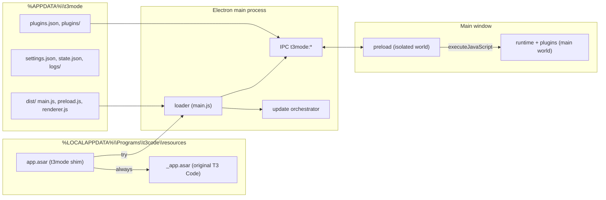

# t3mode architecture

Status: **M3 done** (loader, CLI, page runtime, settings pages, shortcut, and t3mode installing T3 Code's updates), verified on a sandbox copy of T3 Code `0.1.10-nightly.20261114.4669`, and the update path also on a real install. Standalone plugins (section 5) are verified on a sandbox copy of `0.1.10-nightly.20261115.4736`. Decisions are recorded under **Decided**.

## Goal

t3mode adds plugins to the T3 Code desktop app on Windows, the way Vencord does for Discord. T3 Code's own code is never edited. t3mode runs alongside it at startup and changes the interface from inside the window.

The repo ships the loader, the runtime, the settings pages and the plugin SDK. Plugins are projects of their own. Anyone can publish one as a GitHub release, and anyone can install it from its link (see Plugins below). That is the opposite of Vencord, which builds every plugin into one bundle.

Non-goals for v1: macOS support, sandboxing plugins, a plugin registry, computer control, dictation, storing secrets.

## Facts about the target

Checked on this machine against `0.1.10-nightly.20261114.4669`:

| Fact                                         | Value                                                                                                                  | Why it matters                                                                                     |
| -------------------------------------------- | ---------------------------------------------------------------------------------------------------------------------- | -------------------------------------------------------------------------------------------------- |
| Install dir                                  | `%LOCALAPPDATA%\Programs\t3code\`                                                                                      | Per-user, so no admin rights are needed to swap files                                              |
| Entry                                        | `app.asar` → `package.json` `main` = `apps/desktop/dist-electron/boot.cjs`                                             | What the shim has to boot                                                                          |
| Other archives                               | `server.asar`, `app.asar.unpacked`, `wsl-runtime.tar.gz`                                                               | Leave them alone. Only `app.asar` is swapped                                                       |
| Fuse `EnableEmbeddedAsarIntegrityValidation` | off                                                                                                                    | A swapped `app.asar` is accepted. **If upstream turns this on, the whole approach stops working.** |
| Fuse `OnlyLoadAppFromAsar`                   | off                                                                                                                    |                                                                                                    |
| Fuse `RunAsNode`                             | on                                                                                                                     | `ELECTRON_RUN_AS_NODE=1` works, so helper scripts need no separate Node install                    |
| `NODE_OPTIONS` fuse                          | on, but packaged Electron ignores `--require`                                                                          | No way to inject without swapping the archive                                                      |
| Windows                                      | `sandbox: true`, `contextIsolation: true`, `nodeIntegration: false`                                                    | The preload is sandboxed. Plugins must be injected into the main world                             |
| Page bridge                                  | `window.desktopBridge`                                                                                                 | T3 Code's own preload API. Read it, never replace it                                               |
| Updater                                      | electron-updater, GitHub `pingdotgg/t3code`, channel `nightly`, cache `%LOCALAPPDATA%\t3code-updater\pending\`         |                                                                                                    |
| Update off switch                            | env `T3CODE_DISABLE_AUTO_UPDATE` (in `apps/desktop/src/updates/DesktopUpdates.ts`)                                     | Lets t3mode take over updates (see Updates)                                                        |
| Nightly cadence                              | about every 6 h                                                                                                        | Repairing after an update is an everyday path, not an edge case                                    |
| Update feed                                  | `resources/app-update.yml` names the repo and publisher; each release has `<channel>.yml` with the installers' SHA-512 | t3mode reads the same feed as T3 Code's updater                                                    |
| Update channel                               | `updateChannel` in `<T3 home>/userdata/desktop-settings.json` (Settings → About → Update track), else from the version | t3mode follows the channel the user picked in T3 Code                                              |
| Installer                                    | NSIS, per user, signed "CN=T3 Tools Inc"; electron-updater runs it as `--updated /S --force-run`                       | t3mode runs it as `--updated /S`, then re-applies the shim before starting T3 Code                 |
| Detached console processes                   | Node's `detached: true` starts a process without a console, and `powershell.exe` exits at once without one             | The update helper is started through `Start-Process` (see Updates)                                 |
| Stable DOM hooks                             | `data-*` attributes listed in T3 Code's theme guide (`[data-thread-details-card]`, `[data-chat-composer-form]`, …)     | Prefer these over class names, which change between releases                                       |

Re-check all of this with `t3mode doctor` (see CLI) after big upstream releases.

## Overview



## Layers

### 1. Shim (`packages/shim`)

The new `app.asar`. Kept tiny and rarely changed, because every change means reinstalling it.

- Contains `index.js`, a `t3mode.json` marker holding the shim version, and a `package.json` copied from the original with only `main` changed. Electron reads the app's name and version from the entry archive, so they stay T3 Code's.
- `index.js` loads `%APPDATA%\t3mode\dist\main.cjs` **inside try/catch**. If loading fails, it writes `logs\shim.log` and continues.
- Then it always boots the original: `app.setAppPath(_app.asar)`, then `require` the original `main`.
- `T3MODE_DISABLE=1` skips the loader. `SAFE_MODE` is handled by the loader (below).
- Bundled from `packages/shim` with no runtime dependencies and no Effect.

Fixes a t3mod weakness: in t3mod, a broken loader keeps T3 Code from starting.

### 2. Loader (`packages/main`)

Runs in the main process before T3 Code's own code.

Everything here runs **synchronously** (`Effect.runSync` over sync file access), because the shim boots T3 Code right after `require` returns. IPC handlers and the preload hook must exist before T3 Code opens its window.

1. **Safe mode.** Two triggers, each skipping t3mode for one launch:
   - the `SAFE_MODE` file (`pnpm t3mode safe`, or two renderer crashes within 60 s);
   - two launches in a row that never reported `ready` from the page (`state.json` counts them).

   Safe mode still runs the updater (step 5), so an update during safe mode doesn't silently uninstall t3mode.

2. **Settings and state.** JSON files written atomically (write a temp file, then rename), decoded with `Schema`.
3. **IPC.** `t3mode:*` handlers. Every handler checks that the call comes from the main frame of the main T3 Code window. The surface is small and allowlisted.
4. **Preload registration** through `session.registerPreloadScript` on every session. The preload itself exits outside the main window.
5. **Updater** (`Updater.ts`, see Updates). Before T3 Code's main runs, it sets `T3CODE_DISABLE_AUTO_UPDATE=1` unless the user handed updates back to T3 Code.
6. **Boot the original**, always, even when steps 1 to 5 fail.

### 3. Preload (`packages/preload`)

- Runs only in the main `t3code://app` frame. It does nothing in the preview browser, pop-ups or data: pages.
- Exposes `window.t3modeNative` through `contextBridge`. Each method is one IPC call.
- Reads the page scripts from main over IPC (each installed plugin, then `renderer.js`) and runs each in the main world with its own `webFrame.executeJavaScript` call. That gets past the page's CSP and lets plugins reach React-managed DOM. A script that fails is logged, and the rest still run.

### 4. Runtime (`packages/runtime`)

Runs in the page, as one classic script with no imports. Plain TypeScript, no Effect: it is small, runs once per page load, and Effect would add about 100 kB to a script that the preload hands to `executeJavaScript` on every reload.

- `renderer.ts` reads `info` and settings from main, starts the `Runtime`, adds the settings entry and the shortcut, then calls `ready()` so the crash guard counts the launch as healthy.
- `Runtime` starts and stops plugins and keeps settings in memory. Each change is written back through `writeSettings`, which validates it with a Schema in main before it reaches `settings.json`.
- **Disposables.** Everything a plugin creates goes through its API (`css`, `observe`, `listen`, `interval`, `element`, `onCleanup`) and is undone newest first when the plugin stops. Changing an option restarts the plugin.
- **Fault isolation (sync only in v1).** `start` and every API callback are wrapped. A plugin that throws is stopped, its changes are undone, the error goes to `main.log` and a toast points to the settings page, where Retry starts it again. For a plugin that couldn't load, Retry first reads its files again, so a fixed linked plugin starts without a reload. Errors in a plugin's own promises are not attributed yet.
- **Status.** Plugins call `api.report({ state: "active" | "waiting", detail })`. The settings page shows it, so "T3 Code's usage data was not found" after an update is visible instead of a silent no-op.
- **Settings pages** (`ui/settingsPage.ts`, `ui/native.ts`). A "T3 Mode" group is added to T3 Code's settings navigation, after "Connections": a copy of that native group with two entries, like Vencord's. **T3 Mode** shows the version and troubleshooting (logs folder, safe mode, uninstall). **Plugins** has an "Install from GitHub" field and "Check for updates", and lists the installed plugins as cards (switch, status, version and source, search and an enabled/disabled filter). Each plugin has its own page for its options, its source, Update and Remove (Settings / Plugins / name). The pages open in the settings pane itself, with T3 Code's breadcrumb header.
- **Shortcut** (`ui/shortcut.ts`, `lib/keybindings.ts`, main's `T3Keybindings.ts`). Ctrl+Alt+M (Cmd+Alt+M on macOS) opens the Plugins page. It is listed and rebindable in T3 Code's own Settings → Keybindings, as "Run Script: T3 Mode Plugins" with a "T3 Mode" badge.
  - **Why a script command.** T3 Code's keybindings file only accepts its own commands, plus `script.<id>.run` for project scripts, whose ids are free. So t3mode adds `{ "key": "mod+alt+m", "command": "script.t3-mode-plugins.run" }` to `<T3 Code home>/userdata/keybindings.json`. T3 Code shows that entry in Settings → Keybindings and lets the user rebind it there, and it ignores the key press, because no project has that script.
  - **Seeded once.** Main adds the entry on the first start, with an atomic write, and leaves a marker (`shortcut-seeded`). It never edits or removes the user's entries. If the user deletes the binding, it stays deleted, and the T3 Mode page offers a Restore button. If Ctrl+Alt+M is already bound to something else, nothing is added. T3 Code reloads the file on its own, so changes apply without a restart.
  - **Handling the key.** The page listens for key presses before T3 Code does. It resolves each press against T3 Code's live bindings, read from React state, the way T3 Code does: same "When" clauses, and the last matching rule wins. A rebind applies at once and the old key stops working. If those bindings can't be read after an update, it falls back to Ctrl+Alt+M and logs a warning.
  - **Native look.** T3 Code's stylesheet only holds the Tailwind classes T3 Code uses, so `native.ts` copies whole class strings from T3 Code's live settings components (group, row, switch, select, buttons, header) and rebuilds their markup. t3mode's own layout (the card grid, status dots) is plain CSS on T3 Code's theme variables.
  - **No React nodes touched.** The page is appended as the pane's last child, and React's children are hidden with CSS while it is open. Clicking a native section, typing in the settings search or a route change closes it. While it's open, t3mode's entry is marked active and the native one inactive; the native one is restored when the page closes.
  - **Popups stay in the dialog.** Select popups open inside the page, not in `document.body`, because T3 Code's dialog closes on presses outside itself. Escape in a popup closes only the popup.
- **Plugin storage.** `api.storage` is per-plugin `localStorage` (`t3mode:<id>:<key>`), for state that is not a setting.
- **Hot reload.** `renderer.js` is re-read on each page reload, so `pnpm t3mode deploy` then Ctrl+R picks up page changes. Main and preload changes need a restart.

### 5. Plugins (`packages/plugin-sdk`, `packages/shared/src/Plugin*.ts`)

**Decided: standalone plugins, installed from GitHub.** Each plugin is its own project. Its author publishes it as a GitHub release, and anyone installs it by pasting the link on the Plugins page. The repo ships no plugins. This replaces the M2 decision, where plugins were compiled into `renderer.js` from a git-ignored `userplugins/` folder.

**Trust.** A plugin runs in T3 Code's main world, with the same reach as T3 Code's own page code. That includes the DOM, `window.desktopBridge` and `window.t3modeNative`. It can't be sandboxed without losing the DOM, which is the reason plugins exist. So installing a plugin means trusting its author, as with a VS Code extension or an Obsidian plugin. t3mode does four things about it.

- It shows the repo, author and version, with a warning, before it installs anything.
- It pins each install to its version and the SHA-256 of its code.
- It never updates a plugin without a click.
- Safe mode starts T3 Code without any plugin.

**A plugin folder** holds two files. A GitHub release, an installed copy and a linked dev build all have the same two.

- `manifest.json` is `{ "id", "name", "version", "description", "author"?, "api": 1 }`. `id` must match `^[a-z0-9][a-z0-9-]{0,63}$`, because it becomes a folder name, a settings key and a string in generated code. `version` is a semantic version, compared to find updates. `api` is the plugin API's major version, and t3mode refuses a plugin built for another one. The manifest is read without running any code, so the install prompt and the Plugins page can show it.
- `plugin.js` is a CommonJS bundle, at most 5 MiB, whose default export is `definePlugin({ options, start })`. Everything it imports is bundled in. The types and `definePlugin` come from `@t3mode/plugin-sdk`.

```ts
import { definePlugin } from "@t3mode/plugin-sdk";

export default definePlugin({
  options: {
    mode: { type: "select", label: "Mode", choices: [/* … */], default: "a" },
  },
  start(api) {
    api.observe(() => {
      const toggle = api.queryFirst<HTMLButtonElement>(["[data-thread-panel-toggle] button"]);
      /* … */
    });
  },
});
```

**The lockfile.** `<home>/plugins.json` lists what's installed, as `{ "version": 1, "plugins": { "<id>": { "source", "version", "sha256"? } } }`. A source is one of two kinds.

- `{ "kind": "github", "owner", "repo", "tag"? }`. Its files come from the release. The URL is `https://github.com/<owner>/<repo>/releases/latest/download/<file>`, or `/releases/download/<tag>/<file>` when the install was pinned to a tag. They're copied to `<home>/plugins/<id>/`. These URLs aren't GitHub's REST API, so its limit of 60 requests an hour for unauthenticated clients doesn't apply. `sha256` is the hash of the installed `plugin.js`, and a copy that no longer matches it isn't loaded.
- `{ "kind": "local", "path" }`, added by `pnpm t3mode plugin link <folder>`, for developing a plugin. The two files are read from that folder on every page load, so a rebuild and Ctrl+R pick up changes. Only the CLI adds local sources. Main never takes a file path from page code. Its decode of the page's requests accepts GitHub sources only.

A `plugins.json` that doesn't decode, including one with a key that isn't a valid id, reads as empty and is logged. Every install, link and remove is refused until it is fixed or deleted, so a bad edit is never written over.

**Install.** `PluginStore` (in shared, used by main and the CLI) does it in two steps.

1. **Preview.** Parse the link. It can be `owner/repo`, `github.com/owner/repo`, the repo URL or a release tag URL, with an optional `@tag`. Fetch and decode `manifest.json`, check `api` and `id`, and return it for the prompt.
2. **Install**, on confirmation. Fetch the manifest again and refuse if its id differs from the one the user saw. Fetch `plugin.js` with a size cap and hash it. Write each file next to its final name and rename it over, then write the lockfile entry. Because the lockfile entry is written last, a crash midway leaves the old install or a hash mismatch, never a plugin that loads half-updated code.

An id that's already installed from another source is refused. A repo is the same source whatever its tag, so installing `owner/repo@v2` over `owner/repo` pins it, and GitHub names are compared without case. Running the same install twice ends in the same state. In main, requests go through Electron's `net.fetch`, like the updater's. `T3MODE_GITHUB_URL` replaces `https://github.com`, for tests and the sandbox.

**Updates.** "Check for updates" on the Plugins page, and `plugin update` in the CLI, fetch each unpinned GitHub plugin's latest `manifest.json` and compare versions. A newer one shows "Update to x.y" on its card. Nothing updates on its own, because a new release is new code.

**Loading.** The preload asks main for the page scripts. These are each installed plugin's `plugin.js`, wrapped by main, then `renderer.js`. The preload runs each one with its own `webFrame.executeJavaScript` call and `//# sourceURL=t3mode-plugin/<id>.js`, so a plugin that doesn't parse can't stop the others or the runtime. The wrapper registers the plugin's module under its manifest id without running it.

```js
(window.__t3modePlugins ??= []).push({
  id: "<id>",
  load: () => {
    const module = { exports: {} };
    (function (module, exports) {
      /* plugin.js */
    })(module, module.exports);
    return module.exports;
  },
});
```

The runtime calls `load()` inside its fault isolation, so an error in a plugin's top-level code stops only that plugin. It calls `load()` only for a plugin that is on, the first time it starts. A plugin that is off runs none of its code, not even its top level, so its options appear once it is first turned on. A plugin in `plugins.json` whose code didn't register, or whose files fail their checks, shows "Can't load" with the reason, and its card keeps Remove. After an install or update from the page, the preload's `loadPlugin(id)` runs the new code, and the runtime swaps it in without a reload.

**API.** `PluginApi` is a public contract, versioned by `api`. Besides the disposables above, it gives plugins the helpers that know T3 Code. These are `queryFirst`, `currentThreadKey`, `react.findPropsUp` and `react.findHookState`. They stay in t3mode, so when a nightly breaks one, a single t3mode fix repairs every plugin that uses it.

**Writing a plugin.** `templates/plugin` is a starting point. It has the SDK, a build that writes `dist/manifest.json` and `dist/plugin.js`, and a GitHub Action that publishes release `v<version>` with both files when a push to `main` carries a `manifest.json` version that has no release yet. Link its `dist/` folder while developing.

- **Rules.** Do the plugin's work in `start`, through the API, so turning it off undoes it. Drive T3 Code's own controls with `.click()` instead of rebuilding them. Never insert into or move React-owned nodes: overlay with `position: fixed`, or add next to React's children. Re-apply whenever the DOM changes, because React replaces nodes. Keep selectors in the plugin, newest markup first, and look them up with `api.queryFirst`.
- **Reading React state.** `api.react` reads the fiber React attaches to DOM nodes (`__reactFiber$…`). Component names are minified, so lookups match on the shape of the data: `findPropsUp` walks ancestors for props that pass a test, and `findHookState` walks the tree for hook state that passes a type guard. Either returns undefined when the shape changed, and the plugin reports "waiting".

### 6. CLI (`packages/cli`)

`pnpm t3mode <command>`, run from the repo in v1:

| Command     | Does                                                                                                                          |
| ----------- | ----------------------------------------------------------------------------------------------------------------------------- |
| `install`   | Wait for T3 Code to close, rename `app.asar` to `_app.asar`, copy `app.asar.unpacked`, write the shim, copy `dist/`, relaunch |
| `uninstall` | Restore the original, keep `%APPDATA%\t3mode` unless `--purge`                                                                |
| `repair`    | Re-apply the shim after an update overwrote it                                                                                |
| `status`    | Installed? Shim version, T3 Code version, mod enabled, last errors                                                            |
| `deploy`    | Copy freshly built bundles into the home (renderer changes then need only Ctrl+R)                                             |
| `sandbox`   | Copy T3 Code to `.sandbox/`, install there with its own data folders, start it with DevTools on port 9333                     |
| `safe`      | Next launch without the mod                                                                                                   |
| `plugin`    | `list`, `add <link>` (asks first, `--yes` skips), `update [id]`, `remove <id>`, `link <folder>` for a plugin in development   |
| `status`    | Also shows a downloaded update waiting to install, and the update helper's last log lines                                     |
| `doctor`    | (M4) Re-check every fact in _Facts about the target_ (fuses, entry path, updater config)                                      |

`install`, `repair` and `uninstall` refuse to run while T3 Code is open (`--wait` waits for it to close). The new shim is built before anything is moved, and a failed swap puts the original back.

**Foreign shims.** If `app.asar` carries a t3mod or Vencord-style marker that isn't ours, `install` refuses and explains, instead of stacking shims.

## Updates

Every T3 Code update rewrites `app.asar`, which removes the shim. At one nightly every ~6 h, this path is the one that has to be reliable.

**Decided: A.** The options as weighed:

- **A. t3mode owns updates (chosen).** The loader sets `T3CODE_DISABLE_AUTO_UPDATE=1` before T3 Code's main runs, so T3 Code's updater stays idle. t3mode checks the same GitHub nightly feed, downloads the installer and **verifies its Authenticode signature (publisher "T3 Tools Inc")**. When T3 Code quits, a small detached helper:
  1. waits for T3 Code to exit,
  2. runs the installer silently and waits for **that process**,
  3. re-applies the shim,
  4. relaunches.

  The helper knows exactly which installer it's waiting for, and no vanilla T3 Code runs in between.
  Cost: t3mode re-implements check and download, and T3 Code's own update button shows "disabled".

- **B. Guardian (t3mod's approach).** Leave T3 Code's updater on. On quit, if an installer is pending, spawn a watcher that guesses when the installer finished, kills the relaunched vanilla T3 Code, re-swaps and relaunches. Less code. It relies on guessing ("any exe started from %TEMP%"), and it races the installer's own relaunch.

In both, the helper is a PowerShell script. It can't be T3 Code's exe in Node mode, because the installer has to overwrite that exe while the helper is running. `pnpm t3mode repair` stays the manual fallback.

### How it works (M3)

- **Turning T3 Code's updater off.** The loader sets `T3CODE_DISABLE_AUTO_UPDATE=1`, in safe mode too. T3 Code's About page then says automatic updates are disabled by that setting; its Update track select still sets the channel t3mode follows. The switch "Install updates through T3 Mode" on the T3 Mode page (`updates.manage` in `settings.json`, default on) hands updates back to T3 Code from the next launch.
- **Check** (`Updater.ts`, `UpdateFeed.ts`). 20 s after start, then every hour, and on "Check now": read `app-update.yml`, list the repo's releases through GitHub's API, take the newest release on the channel that has `<channel>.yml`, read it, and compare versions (semver with prerelease fields, so nightlies order by date and build). Requests go through Electron's `net.fetch`, so system proxies apply as they do for T3 Code.
- **Download and verify.** The installer for the CPU (`…-x64.exe` or `…-arm64.exe`) goes to `<home>/updates/<version>/`, with progress shown live on the T3 Mode page. It must match the size and SHA-512 from `<channel>.yml`, and `Get-AuthenticodeSignature` must report a valid signature whose common name is a publisher from `app-update.yml` ("T3 Tools Inc"). Anything else is deleted and reported. `updates/ready.json` records the verified installer, so a download survives a restart; the next launch after the install sees the new version and deletes it.
- **Install on quit.** In Electron's `will-quit`, if an update is ready, the loader starts `update-helper.ps1` (deployed to `<home>/dist`), which:
  1. waits for every process running from the install folder to exit (up to 2 minutes, else it gives up until the next quit);
  2. runs the installer with `--updated /S` and waits for it;
  3. re-applies the shim by running `repair.cjs` with T3 Code's new exe in Node mode (`ELECTRON_RUN_AS_NODE=1`, with `process.noAsar` so .asar files are moved as files). `repair.cjs` is the CLI's own `applyShim`, bundled, so the CLI and the helper share one tested swap;
  4. after "Restart now", starts T3 Code again with the arguments it had.

  It logs each step to `logs/update.log`, and only one helper runs at a time.

- **Starting the helper.** It has to outlive T3 Code. Node's `detached` option starts a process without a console, and `powershell.exe` exits at once without one; a non-detached child is killed with T3 Code. So the loader runs a short PowerShell, attached and waited for (about half a second at quit), that starts the helper with `Start-Process`. The helper gets its own hidden console and is not tied to T3 Code (`HelperLaunch.ts`).
- **Sandbox.** The real installer always updates the real install, so the sandbox never runs it. `pnpm t3mode sandbox` writes `.sandbox/fake-installer.cmd`, which does to `app.asar` what an update does (puts a vanilla archive over the shim), and the loader runs that instead. Check, download and verification use the real feed.

## Repo layout

```
t3mode/
  packages/
    shared/      file layout, IPC contract, version, plugin sources and the plugin store
                 (bundled into each layer; the page and preload import only its plain files)
    plugin-sdk/  @t3mode/plugin-sdk: definePlugin and the plugin API types
    shim/        app.asar entry -> dist/index.cjs
    main/        loader: safe mode, IPC, preload hook, file log, updater -> dist/main.cjs;
                 assets/update-helper.ps1
    preload/     bridge and injection -> dist/preload.cjs
    runtime/     page code -> dist/renderer.iife.js: plugin runtime, settings pages
    cli/         install, repair, uninstall, deploy, status, safe, sandbox, plugin (run from source);
                 dist/repair.cjs for the update helper
  templates/
    plugin/      starting point for a standalone plugin, with its release workflow
  docs/
  .sandbox/      dev copy of T3 Code (git-ignored)
```

**Decided: stack, matching T3 Code's own repo** (`pingdotgg/t3code`):

- TypeScript run natively by Node (type stripping), `tsconfig.base.json` copied from T3 Code.
- **Effect 4.1.3** and `@effect/platform-node` in the loader and the CLI, written in T3 Code's style: `Context.Service` classes, `Layer`, `Effect.fn`, `Schema.TaggedError`, `effect/cli`, `effect/process`.
- **effect-tsgo** typechecks with T3 Code's Effect language-service rules (`tsconfig.effect.json`, copied).
- **vite-plus 1.4.0** (`vp`): `vp pack` (tsdown) bundles each layer, `vp test` (vitest), `vp lint` (oxlint), `vp fmt` (oxfmt).
- pnpm 12 workspaces with a catalog pinned to T3 Code's versions.
- No Effect in the shim (it must never fail), the preload (sandboxed and tiny) or the page runtime (see Runtime above).

## Testing

- **Unit (vitest).** Now: safe-mode decisions; the asar swap on a fake install (install, refresh, re-apply after an update, uninstall, refusing another mod); option validation, thread keys, keybinding matching (key names, "When" clauses, last rule wins, finding the default key in the file), the settings schema, and the update feed (version order, `app-update.yml` and `<channel>.yml`, picking the release and installer, the signature decision, quoting the helper's command line). For plugins: parsing GitHub links, release URLs and the code wrapper (run in `node:vm`); `PluginStore` end to end against a local HTTP server standing in for GitHub (install, idempotence, the refusals, the hash check, link, remove, update checks); and main's decode, which refuses a local source from page code. Later: runtime lifecycle and disposables, settings migrations.
- **Sandbox.** `pnpm t3mode sandbox`, then DevTools on port 9333. M1 was verified there: badge injected, `desktopBridge` intact, a crashing loader still lets T3 Code boot (error in `shim.log`), `safe` skips one launch, `uninstall` restores the original. M2 was verified there too: plugins found in `userplugins/` and none on a clean clone, settings and options persist, turning a plugin off removes everything it added, and the shortcut is added once, can be rebound in Settings → Keybindings, and can be restored after it's deleted. M3 was verified there: the real nightly feed found `0.1.10-nightly.20261114.4709`, its 372 MB installer downloaded with live progress and passed SHA-512 and signature checks; "Restart now" and a plain quit both ran the helper, the stand-in installer replaced the shim, `repair.cjs` under T3 Code's exe put it back, and after "Restart now" T3 Code started again with its arguments and t3mode loaded. Turning the setting off and on applies at the next launch.
  Standalone plugins were verified there with three linked plugins and a stand-in GitHub (`T3MODE_GITHUB_URL`).
  - A plugin that doesn't parse is logged and skipped, and one whose top level throws shows "Can't load" with the error. The others and the runtime still start.
  - Installing `acme/example-plugin` from the Plugins page showed the prompt, downloaded both files through `net.fetch`, wrote `plugins.json` and started the plugin without a reload.
  - "Check for updates" found 1.1.0, and "Update to 1.1.0" swapped in the new code and removed the old code's stylesheet.
  - After a reload, the installed copy loaded from disk. After its `plugin.js` was edited, it was refused as changed since install.
  - A plugin whose top level counts its runs counted 0 after a reload while it was off, and 1 once it was turned on.
  - Requests to the stand-in carried Chromium's headers, so they go through `net.fetch`. The T3 Code update check still ran against the real feed.
  - Retry re-read a linked plugin that had been fixed on disk and started it. Remove deleted the files, the lockfile entry and everything the plugin added.
  - Against the real `https://github.com`, a repo whose release has no `manifest.json` and a missing repo both got a message, and main refused a local source sent from page code.
- **Real install.** On the real T3 Code install, the helper ran T3 Code's own installer and put the shim back, and T3 Code started with t3mode loaded. `pnpm t3mode status` shows the helper's log after each update.
- **DOM (vitest + happy-dom).** Plugins against saved HTML snapshots of T3 Code screens.
- **Compat canary (later).** A scheduled job pulls the latest nightly, extracts `app.asar`, runs `doctor` checks, and checks the selectors that plugins use against the real UI. Then breakage shows up in CI before it shows up on the desktop.

## Milestones

1. **M0.** Repo and this design. ✔
2. **M1.** Shim, loader, crash guard, logs, CLI `install` / `uninstall` / `repair` / `status`, and a "hello" plugin (a badge in the corner). ✔ Proven on a sandbox copy of the real app.
3. **M2.** Runtime, plugin API, settings pages, shortcut, user plugins. ✔ Proven on the sandbox.
4. **M3.** Update handling (option A). ✔ Proven on the sandbox and on a real install.
5. **Standalone plugins.** The plugin SDK, `plugins.json`, install from GitHub, `plugin link`, and the plugin template. ✔ Proven on the sandbox, with a stand-in for GitHub's release downloads.
6. **M4.** Doctor, compat canary, DOM snapshot tests. ← next
7. **Later: patch engine** (see below).

## Later: patch engine

This would be Vencord-style find-and-replace on T3 Code's own code, for changes the DOM and React state can't make. One example is a real `t3mode.*` keybinding command instead of the script workaround. It is not planned yet; the notes below record what's known.

- **UI bundles.** T3 Code's main process serves the web client from `server.asar/apps/server/dist/client` through `electron.protocol.handle`. The loader runs before T3 Code's main, so it could wrap `protocol.handle` and patch matching JS responses in memory, without touching files on disk.
- **Server.** The server is a separate process: T3 Code's exe with `ELECTRON_RUN_AS_NODE=1`, entry `server.asar/apps/server/dist/bin.mjs`. Keybinding validation lives there, so patching it means either patching `server.asar` on disk, which every update undoes, or a `--require` / `NODE_OPTIONS` hook. Whether the fuses allow that hook hasn't been checked. In WSL mode the server runs under `wsl.exe` and can't be hooked from the loader.
- **Fragility.** Patches would be regexes against minified code that changes every nightly. Each patch needs a "find" that fails loudly and is skipped, like a plugin's "waiting" status. The compat canary (M4) should run every patch against each new nightly.

## Open questions

Settled: written from scratch (t3mod only informs the design). t3mode itself is installed from the repo. t3mode and the SDK are MIT licensed, so plugin authors may use the SDK and license their own plugins as they like. Plugins are shared as standalone GitHub releases. The first one is `Hezaerd/t3mode-thread-details-collapsed`.

- **Publishing the SDK.** `@t3mode/plugin-sdk` is on npm, published by the `t3mode` org. To publish, bump `version` in `packages/plugin-sdk/package.json` and merge to `main`. `.github/workflows/publish-sdk.yml` publishes any version npm doesn't have yet through npm trusted publishing, so no token is stored. Pull requests that touch the SDK run it as a dry run. Its `repository` field must stay `Hezaerd/t3mode`, because npm checks it against the workflow's repo. A change to `PluginApi` that breaks plugins needs a new major version and a new `api` number.
- **Discovery.** Install-by-link needs no registry. If one is wanted later, a GitHub repo holding a JSON list that authors add to by pull request would do, the way Obsidian lists its plugins.
