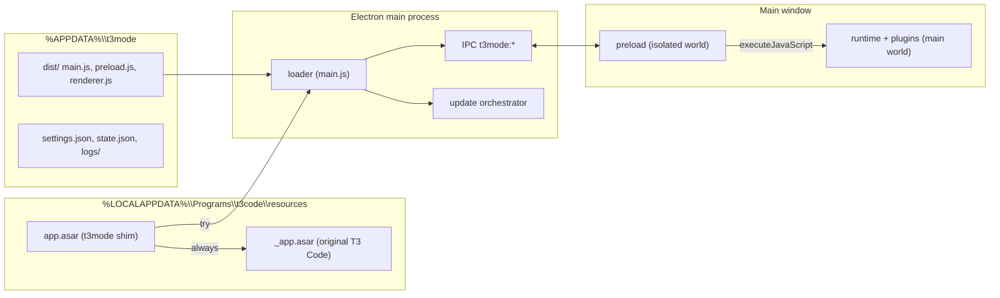

# t3mode architecture

Status: **draft, nothing implemented yet.** Sections marked **Decision** are proposals waiting for a yes or a change.

## Goal

t3mode adds plugins to the T3 Code desktop app on Windows, the way Vencord does for Discord. T3 Code's own code is never edited. t3mode runs alongside it at startup and changes the interface from inside the window.

First plugins, the reason this project exists:

- **Thread details collapsed by default.** The card starts closed and still opens when clicked.
- **Weekly usage near the composer.** A copy of the weekly usage indicator sits next to the composer.

Non-goals for v1: macOS support, loading third-party plugins at runtime, computer control, dictation, storing secrets.

## Facts about the target

Checked on this machine against `0.1.10-nightly.20261114.4669`:

| Fact | Value | Why it matters |
|---|---|---|
| Install dir | `%LOCALAPPDATA%\Programs\t3code\` | Per-user, so no admin rights are needed to swap files |
| Entry | `app.asar` → `package.json` `main` = `apps/desktop/dist-electron/boot.cjs` | What the shim has to boot |
| Other archives | `server.asar`, `app.asar.unpacked`, `wsl-runtime.tar.gz` | Leave them alone. Only `app.asar` is swapped |
| Fuse `EnableEmbeddedAsarIntegrityValidation` | off | A swapped `app.asar` is accepted. **If upstream turns this on, the whole approach stops working.** |
| Fuse `OnlyLoadAppFromAsar` | off | |
| Fuse `RunAsNode` | on | `ELECTRON_RUN_AS_NODE=1` works, so helper scripts need no separate Node install |
| `NODE_OPTIONS` fuse | on, but packaged Electron ignores `--require` | No way to inject without swapping the archive |
| Windows | `sandbox: true`, `contextIsolation: true`, `nodeIntegration: false` | The preload is sandboxed. Plugins must be injected into the main world |
| Page bridge | `window.desktopBridge` | T3 Code's own preload API. Read it, never replace it |
| Updater | electron-updater, GitHub `pingdotgg/t3code`, channel `nightly`, cache `%LOCALAPPDATA%\t3code-updater\pending\` | |
| Update off switch | env `T3CODE_DISABLE_AUTO_UPDATE` (in `apps/desktop/src/updates/DesktopUpdates.ts`) | Lets t3mode take over updates (see Updates) |
| Nightly cadence | about every 6 h | Repairing after an update is an everyday path, not an edge case |
| Stable DOM hooks | `data-*` attributes listed in T3 Code's theme guide (`[data-thread-details-card]`, `[data-chat-composer-form]`, …) | Prefer these over class names, which change between releases |

Re-check all of this with `t3mode doctor` (see CLI) after big upstream releases.

## Overview



## Layers

### 1. Shim (`packages/shim`)

The new `app.asar`. Kept tiny and rarely changed, because every change means reinstalling it.

- Contains `package.json`, `index.js` and a `t3mode.json` marker holding the shim version.
- `index.js` loads `%APPDATA%\t3mode\dist\main.js` **inside try/catch**. If loading fails, it logs the error and continues.
- Then it always boots the original: `app.setAppPath(_app.asar)`, restore the original `name` and `version`, `require` the original `main`.
- Honors a `SAFE_MODE` file and the env `T3MODE_DISABLE=1`, both of which skip the loader.

Fixes a t3mod weakness: in t3mod, a broken loader keeps T3 Code from starting.

### 2. Loader (`packages/main`)

Runs in the main process before T3 Code's own code.

1. **Crash guard.** Two window crashes within 60 s write `SAFE_MODE`. The next launch skips the mod once, but **keeps the update orchestrator running**, so an update during safe mode doesn't silently uninstall t3mode.
2. **Settings and state.** JSON files written atomically (write a temp file, then rename). Schema version and migrations.
3. **IPC.** `t3mode:*` handlers. Every handler checks that the call comes from the main frame of the main T3 Code window. The surface is small and allowlisted.
4. **Preload registration** through `session.registerPreloadScript`, applied to the main window only.
5. **Update orchestrator** (see Updates).
6. **Boot the original**, always, even when steps 1 to 5 fail.

### 3. Preload (`packages/preload`)

- Runs only in the main `t3code://app` frame. It does nothing in the preview browser, pop-ups or data: pages.
- Exposes `window.t3modeNative` through `contextBridge`. Each method is one IPC call.
- Reads `renderer.js` from main over IPC and runs it in the main world with `webFrame.executeJavaScript`. That gets past the page's CSP and lets plugins reach React-managed DOM.

### 4. Runtime (`packages/runtime`)

Runs in the page.

- Starts and stops plugins and keeps settings in memory.
- **Disposables.** Everything a plugin creates (CSS, observers, listeners, DOM nodes, timers) is registered with its API and undone in reverse order when the plugin stops.
- **Fault isolation covers sync and async errors.** API callbacks are wrapped, `api.async()` attributes rejected promises to the plugin, and the runtime watches `unhandledrejection`. A plugin that fails is stopped, its changes are undone and a toast reports it. t3mod only isolates sync errors.
- **Compatibility gate.** Each plugin declares the selectors it needs. If they aren't found within a timeout, the plugin is marked *incompatible with T3 Code vX*, not left half-applied.
- **Settings page.** Adds a "t3mode" entry to T3 Code's settings navigation, plus a hotkey fallback (Ctrl+Alt+M) in case injection fails.
- **Hot reload.** `renderer.js` is re-read on each page reload, so `pnpm dev` only needs Ctrl+R.

### 5. Plugins (`packages/plugins/<id>`)

```ts
export default definePlugin({
  id: "thread-details-collapsed",
  name: "Thread details collapsed by default",
  requires: [sel.threadDetailsCard],
  options: { rememberManualOpen: { type: "boolean", default: true } },
  start(api) { /* … */ },
});
```

- Compiled into `renderer.js`. Nothing is loaded at runtime, so there's no remote code.
- Plugins reach T3 Code only through the API and the shared `selectors.ts`.
- **Rules.** Drive T3 Code's own controls with `.click()` instead of rebuilding them. Never move React-owned nodes: copy their content, or add next to them. Re-apply whenever the DOM changes, because React replaces nodes.

### 6. CLI (`packages/cli`)

`pnpm t3mode <command>`, run from the repo in v1:

| Command | Does |
|---|---|
| `install` | Wait for T3 Code to close, rename `app.asar` to `_app.asar`, copy `app.asar.unpacked`, write the shim, copy `dist/`, relaunch |
| `uninstall` | Restore the original, keep `%APPDATA%\t3mode` unless `--purge` |
| `repair` | Re-apply the shim after an update overwrote it |
| `status` | Installed? Shim version, T3 Code version, mod enabled, last errors |
| `safe` | Next launch without the mod |
| `doctor` | Re-check every fact in *Facts about the target* (fuses, entry path, updater config) |

**Foreign shims.** If `app.asar` carries a t3mod or Vencord-style marker that isn't ours, `install` refuses and explains, instead of stacking shims.

## Updates

Every T3 Code update rewrites `app.asar`, which removes the shim. At one nightly every ~6 h, this path is the one that has to be reliable.

**Decision: who installs T3 Code updates.**

- **A. t3mode owns updates (recommended).** The loader sets `T3CODE_DISABLE_AUTO_UPDATE=1` before T3 Code's main runs, so T3 Code's updater stays idle. t3mode checks the same GitHub nightly feed, downloads the installer and **verifies its Authenticode signature (publisher "T3 Tools Inc")**. When T3 Code quits, a small detached helper:
  1. waits for T3 Code to exit,
  2. runs the installer silently and waits for **that process**,
  3. re-applies the shim,
  4. relaunches.

  The helper knows exactly which installer it's waiting for, and no vanilla T3 Code runs in between.
  Cost: t3mode re-implements check and download, and T3 Code's own update button shows "disabled".
- **B. Guardian (t3mod's approach).** Leave T3 Code's updater on. On quit, if an installer is pending, spawn a watcher that guesses when the installer finished, kills the relaunched vanilla T3 Code, re-swaps and relaunches. Less code. It relies on guessing ("any exe started from %TEMP%"), and it races the installer's own relaunch.

In both, the helper is a PowerShell script. It can't be T3 Code's exe in Node mode, because the installer has to overwrite that exe while the helper is running. `pnpm t3mode repair` stays the manual fallback.

## Repo layout

```
t3mode/
  packages/
    shim/        app.asar content (index.js, package.json, t3mode.json)
    main/        loader, crash guard, IPC, settings, updates
    preload/     bridge and injection
    runtime/     plugin lifecycle, API, settings page
    plugins/     one folder per plugin, plus selectors.ts
    cli/         install, uninstall, repair, status, safe, doctor
    shared/      IPC contract types, paths, settings schema
  scripts/       build.ts (esbuild), dev.ts (watch + deploy)
  docs/
  test/
```

**Decision: stack.** TypeScript, pnpm workspaces, esbuild (one bundle per layer), vitest. Same family of tools as T3 Code itself.

## Testing

- **Unit (vitest).** Runtime lifecycle and disposables, settings migrations, asar swap logic on a fake install dir, update helper state machine.
- **DOM (vitest + happy-dom).** Plugins against saved HTML snapshots of T3 Code screens.
- **Compat canary (later).** A scheduled job pulls the latest nightly, extracts `app.asar`, runs `doctor` checks, and checks each plugin's `requires` selectors against the real UI. Then breakage shows up in CI before it shows up on the desktop.

## Milestones

1. **M0.** Repo and this design. ← now
2. **M1.** Shim, loader, crash guard, logs, CLI `install` / `uninstall` / `repair` / `status`, and a "hello" plugin (a badge in the corner). Proven on the real app.
3. **M2.** Runtime, plugin API, settings page, then the two real plugins.
4. **M3.** Update handling (option A or B).
5. **M4.** Doctor, compat canary, DOM snapshot tests.

## Open questions

- **Reusing t3mod.** Borrow code from your friend's t3mod (needs their permission and a license), or write it from scratch and keep only the lessons?
- **Who uses it.** Just you, installed from the repo, or packaged later so others can install it?
- **Weekly usage data.** Copy it from the DOM (v1), or read it from `desktopBridge` or T3 Code's server connection if that data is exposed there?
